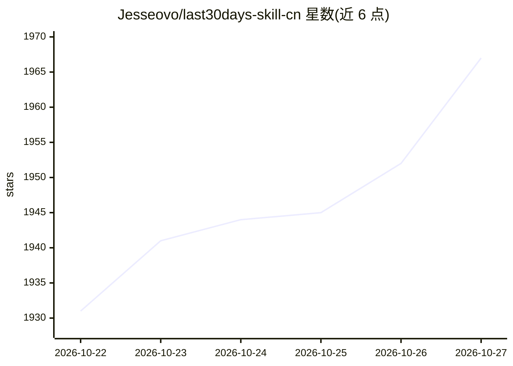

# Jesseovo/last30days-skill-cn

⭐ 1,967 · Python · NOASSERTION · 推送 2026-10-21 · [GitHub](https://github.com/Jesseovo/last30days-skill-cn) · [官网](https://jesseovo.github.io/last30days-skill-cn/) · 个人维护 · 中文 README

**给 AI Agent 的中文互联网研究 Skill：检索 8 平台近 30 天讨论并附来源**

面向 Claude Code、Codex、Cursor、Gemini CLI 等具备命令行执行能力 Agent 的研究技能（基于 Matt Van Horn 的 last30days-skill 中文本地化）。默认覆盖微博、小红书、B站、知乎、抖音、微信公众号、百度、今日头条 8 个中文平台，可加 Hacker News、GitHub、Reddit；按相关性、时效与互动排序，做跨平台归并，输出 Markdown/JSON/HTML 报告并保留原始链接。另提供无需安装的每日全网热榜网页（北京时间 08/12/20 点更新），可自行部署定时发布。限制：平台登录态与接口可用性影响覆盖范围，公开搜索缺少可靠互动数据与精确日期。安装方式为复制一句话交给 Agent 完成。

## 筛选速览

| 维度 | 判定 | 备注 |
|---|---|---|
| AI 角色 | `ai-ecosystem` | LLM/agent 周边工具 |
| 许可风险 | `none` | NOASSERTION |
| 部署形态 | `None` |  |
| 模型依赖 | locked-api |  |
| 硬件要求 | — | 无带数字的原话,不猜 |
| 安装摩擦 | `low` | 无编译、无系统依赖或容器化 |
| 成熟度 | — | 结构信号不足 |

## 能力要点

- 默认检索 8 个中文平台，可扩展 Hacker News/GitHub/Reddit 及上游 skill 海外来源
- 输出 Markdown、JSON 与可离线打开的 HTML 报告，保留原始来源链接
- 每日全网热榜聚合国内热搜、科技资讯与 Hacker News，定时自动更新
- 支持 Claude Code、Codex、Cursor、Gemini CLI 等命令行 Agent，一句话完成安装与运行

## 适用场景

- 研究某产品或话题最近 30 天在中文互联网的讨论并附来源
- 每天浏览聚合全网热搜与科技资讯的热榜
- 对比不同平台对同一话题的评价，生成跨平台报告

## 场景标签

`网页抓取` `精选清单` · 领域:效率与自动化

## 证据(README 行号)

> L4:  给 AI Agent 的研究技能，也是你每天打开的一小份热榜。
> L26: 支持 Claude Code、Codex、Cursor、Gemini CLI 等具备命令行执行能力的 Agent。安装、环境检查和运行都交给它；需要你登录的平台，它会提示你完成。

## 星数曲线

2026-10-22 1,931 → 2026-10-27 1,967（+36）

---
*卡片 v1 · prompt 1.4 · 生成 2026-10-21 · 置信度 mid · 依据 README sha `46c6cce2ad9c` · [字段定义](../../DATASET.md)*
