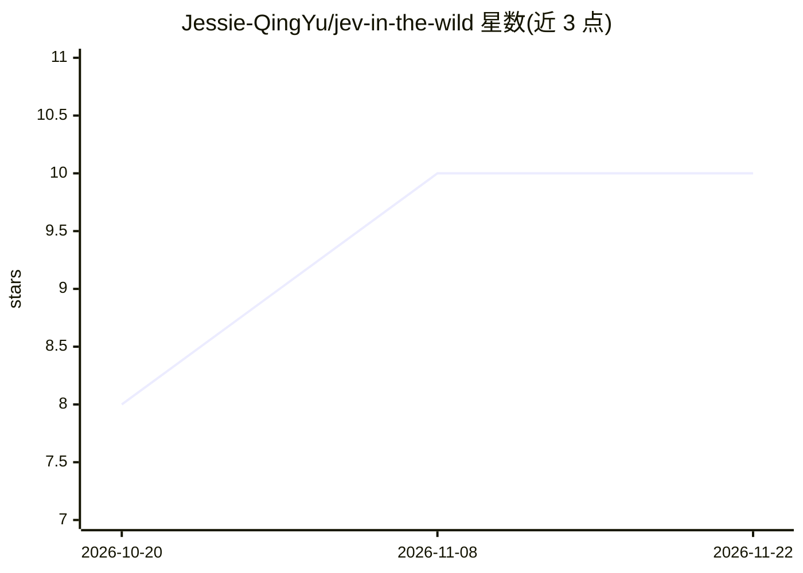

# Jessie-QingYu/jev-in-the-wild

⭐ 10 · JavaScript · MIT · 推送 2026-11-21 · [GitHub](https://github.com/Jessie-QingYu/jev-in-the-wild) · [官网](https://jessie.romeos.cc/full/apps/jev-tracker) · 个人维护

**TypeSafe AI Jev 模型的真实用例、开源项目与批评聚合清单**

围绕 TypeSafe AI 的 Jev 决策模型维护的资源索引：收录 505 条条目（281 个开源项目、74 个用例、111 条分析与批评），其中 260 条来自 Reddit、Hacker News、YouTube 和博客等 GitHub 之外的一手报道。数据源为 data/entries.json，README 由其生成，每日更新并提供可搜索的可视化追踪站点。区别于常规 awesome list 之处在于设有专门的失败与批评板块，且声明与 TypeSafe AI 无隶属关系。

## 筛选速览

| 维度 | 判定 | 备注 |
|---|---|---|
| AI 角色 | `ai-knowledge` | 知识聚合/清单类 |
| 许可风险 | `permissive` | MIT |
| 部署形态 | `None` |  |
| 模型依赖 | — | README 未给出锁定关系 |
| 硬件要求 | — | 无带数字的原话,不猜 |
| 安装摩擦 | `low` | 无编译、无系统依赖或容器化 |
| 成熟度 | — | 结构信号不足 |

## 能力要点

- 505 条条目中 260 条来自 Reddit/HN/YouTube/博客等非 GitHub 来源
- 设专门的 'Where Jev struggles' 板块收录失败报告与负面结果
- 以 data/entries.json 为数据源，README 由数据生成，可 fork 复用
- 每日扫描更新，配有可搜索过滤的在线追踪站

## 适用场景

- 评估 Jev 是否适合我的分类/路由场景前，先查已有实测结果
- 查找基于 Jev 或 Jev 兼容的开源替代模型项目
- 了解社区对 Jev 性能宣传的独立验证与批评意见

## 场景标签

`精选清单` · 领域:学习与行业

## 证据(README 行号)

> L3: **Real-world use cases, open-source projects, benchmarks and criticism of Jev, TypeSafe AI's System One model — what
> L10: 2. **It includes the criticism.** An awesome list is promotional by construction. This one has a section for what d
> L11: 3. **It is data, not prose.** `data/entries.json` is the source of truth and this README is generated from it. Fork

## 星数曲线

2026-10-20 8 → 2026-11-22 10（+2）

---
*卡片 v1 · prompt 1.4 · 生成 2026-11-20 · 置信度 high · 依据 README sha `ca4b1e4546f7` · [字段定义](../../DATASET.md)*
