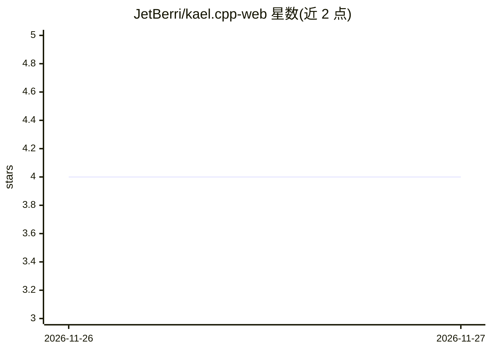

# JetBerri/kael.cpp-web

⭐ 4 · SCSS · Apache-2.0 · 推送 2026-11-09 · [GitHub](https://github.com/JetBerri/kael.cpp-web) · [官网](https://kaelcpp.dev) · 个人维护

**kael.cpp 深度学习框架的配套网站与教学手册**

kael.cpp 项目网站的源码，内容为一本逐层重建 kael C++ 深度学习框架的书、设计决策记录（ADR）以及开放贡献的知识库，讲解深度学习系统的运作方式。站点使用 Zola 0.23 构建，支持本地预览、内部链接检查与静态构建，通过 GitHub Actions 部署到 GitHub Pages；贡献规范写在 CONTRIBUTING.md 与站点 /contributing 页面。采用 Apache 2.0 许可。

## 筛选速览

| 维度 | 判定 | 备注 |
|---|---|---|
| AI 角色 | `ai-knowledge` | 知识聚合/清单类 |
| 许可风险 | `permissive` | Apache-2.0 |
| 部署形态 | `None` |  |
| 模型依赖 | — | README 未给出锁定关系 |
| 硬件要求 | — | 无带数字的原话,不猜 |
| 安装摩擦 | `low` | 无编译、无系统依赖或容器化 |
| 成熟度 | — | 结构信号不足 |

## 能力要点

- 逐章组织的教学书（content/book/），逐层重建框架
- 设计决策记录（ADR）与社区文章、术语表
- Zola 构建，支持链接检查（zola check）
- GitHub Actions 自动部署至 GitHub Pages

## 适用场景

- 跟随书本从零逐层学习深度学习框架实现
- 查阅 kael.cpp 的设计决策记录
- 以社区文章形式贡献深度学习系统知识

## 场景标签

`教程课程` · 领域:学习与行业

## 证据(README 行号)

> L3: Source of the kael.cpp website: the book that rebuilds the kael deep learning framework one layer at a time, design 
> L20: content/book/        one page per chapter of the book

## 星数曲线

2026-11-26 4 → 2026-11-27 4（+0）

---
*卡片 v1 · prompt 1.4 · 生成 2026-11-26 · 置信度 high · 依据 README sha `4a56e643de28` · [字段定义](../../DATASET.md)*
