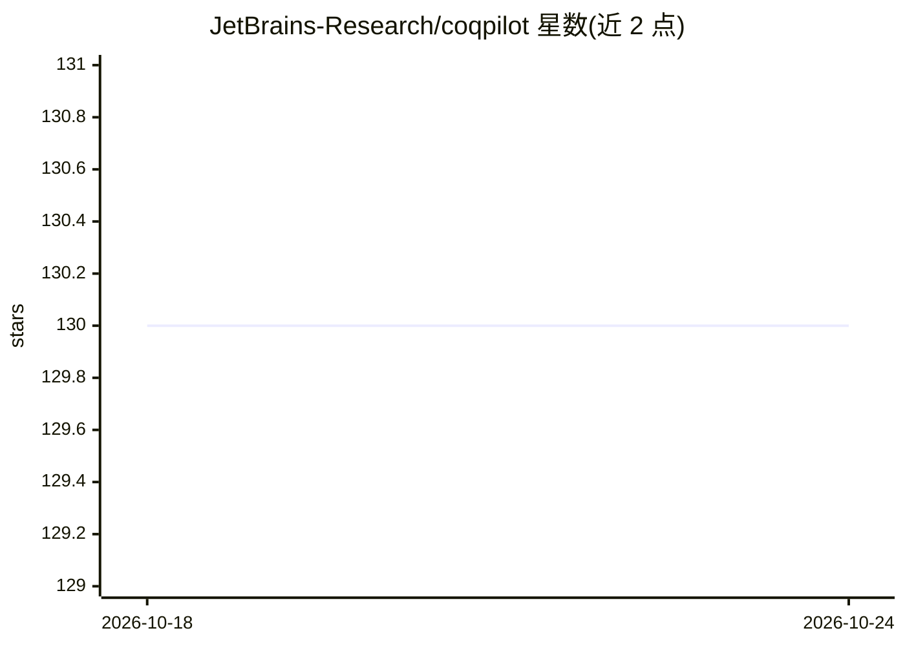

# JetBrains-Research/coqpilot

⭐ 130 · TypeScript · LGPL-2.1 · 推送 2026-04-15 · [GitHub](https://github.com/JetBrains-Research/coqpilot) · [官网](https://coqpilot.net) · 组织维护

**用 LLM 自动补全 Coq 证明的 VSCode 扩展**

面向 Coq/Rocq 证明开发者的 VSCode 扩展：对文件中每个 admit 目标，从多个补全服务（预定义策略、OpenAI、本地 LM Studio、Grazie）并发生成候选证明，再经 coq-lsp（要求 0.2.2+8.19 版本）类型检查，仅在找到有效证明时替换进编辑器；支持将编译器错误回传给 LLM 做多轮修复。已证明定理被解析为消息历史以保持风格。默认仅启用预定义 auto. 策略与 gpt-3.5（需自配 apiKey）。由 JetBrains Research 编程语言与工具实验室团队维护，处于 beta 阶段，设置项可能频繁变动。

## 筛选速览

| 维度 | 判定 | 备注 |
|---|---|---|
| AI 角色 | `ai-native` | 本体是模型或模型工具 |
| 许可风险 | `viral` | LGPL-2.1 |
| 部署形态 | `library` | 以包/库形式分发 |
| 模型依赖 | — | README 未给出锁定关系 |
| 硬件要求 | — | 无带数字的原话,不猜 |
| 安装摩擦 | `low` | 无编译、无系统依赖或容器化 |
| 成熟度 | `idea` | |

## 能力要点

- 多服务多模型并发生成候选证明，经 coq-lsp 类型检查通过才替换
- 编译器错误回传 LLM 的多轮证明修复（可配置轮数）
- 已完成定理解析为 LLM 消息历史以保持证明风格
- 支持 OpenAI、本地 LM Studio、Grazie 及预定义策略四类补全服务

## 适用场景

- 补全 Coq 文件中遗留的 admit 证明目标
- 对选区或整个文件的证明空洞批量尝试自动证明
- 实验不同模型与参数对证明生成成功率的影响

## 场景标签

`代码生成` · 领域:编码与开发

## 证据(README 行号)

> L5: `CoqPilot` is a Visual Studio Code extension that is designed to help automate writing of Coq proofs. It uses Large 
> L27: `CoqPilot` fetches proofs from multiple completion services. Now we support:
> L37: For each `admit.` present in the file, an independent completion process is issued. If a valid proof is found, it i

## 星数曲线

2026-10-18 130 → 2026-10-24 130（+0）

---
*卡片 v1 · prompt 1.4 · 生成 2026-10-23 · 置信度 high · 依据 README sha `6a00e9147f2c` · [字段定义](../../DATASET.md)*
