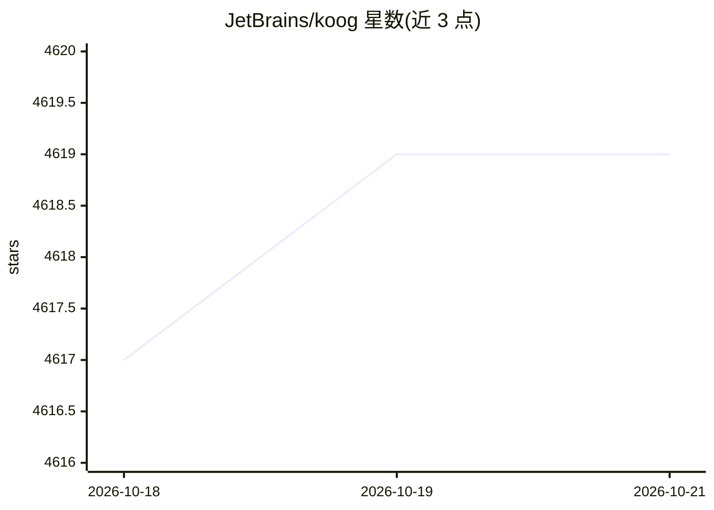

# JetBrains/koog

⭐ 4,619 · Kotlin · Apache-2.0 · 推送 2026-10-16 · [GitHub](https://github.com/JetBrains/koog) · [官网](https://docs.koog.ai) · 组织维护

**面向 Kotlin/Java 开发者的跨平台 AI agent 构建框架**

JetBrains 孵化的 JVM（Kotlin/Java）AI agent 框架，用 Kotlin Multiplatform 在 JVM、JS、WasmJS、Android、iOS 等目标上运行 agent。提供重试与持久化的容错机制、历史压缩以优化 token、图工作流、流式 API、自定义工具、向量嵌入与 RAG 记忆、OpenTelemetry 可观测性（W&B Weave、Langfuse）、Spring Boot/Ktor 集成，以及 MCP 与 ACP 协议支持。可接入 Google、OpenAI、Anthropic、DeepSeek、OpenRouter、Ollama、Bedrock 等 LLM 提供方。JVM 目标需 JDK 17 以上，通过 Gradle/Maven 依赖安装。

## 筛选速览

| 维度 | 判定 | 备注 |
|---|---|---|
| AI 角色 | `ai-ecosystem` | LLM/agent 周边工具 |
| 许可风险 | `permissive` | Apache-2.0 |
| 部署形态 | `None` |  |
| 模型依赖 | local-ok | 支持本地模型 |
| 硬件要求 | — | 无带数字的原话,不猜 |
| 安装摩擦 | `medium` | 含编译或系统依赖之一 |
| 成熟度 | `idea` | |

## 能力要点

- Kotlin Multiplatform 部署到 JVM、JS、WasmJS、Android、iOS
- 重试与 agent 持久化恢复、历史压缩优化 token
- 内置 MCP 与 ACP 协议集成、RAG 向量记忆
- OpenTelemetry 可观测性（W&B Weave、Langfuse）与 Spring Boot/Ktor 集成

## 适用场景

- 在现有 JVM/Kotlin 后端服务中嵌入 AI agent
- 构建跨平台（含移动端与浏览器）的 agent 应用
- 需要切换或混用多家 LLM 提供方的 agent 工程

## 场景标签

`Agent 框架` · 领域:Agent 开发

## 证据(README 行号)

> L25: Koog is a Kotlin-based framework designed to build and run AI agents entirely in idiomatic Kotlin and Java API. It 
> L31: - **Multiplatform development**: Deploy agents across JVM, JS, WasmJS, Android, and iOS targets using Kotlin Multip

## 星数曲线

2026-10-18 4,617 → 2026-10-21 4,619（+2）

---
*卡片 v1 · prompt 1.4 · 生成 2026-10-20 · 置信度 high · 依据 README sha `0bb12d3c76ad` · [字段定义](../../DATASET.md)*
