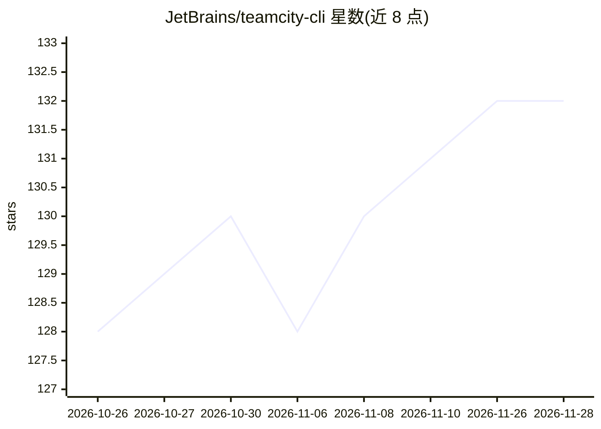

# JetBrains/teamcity-cli

⭐ 132 · Go · Apache-2.0 · 推送 2026-11-25 · [GitHub](https://github.com/JetBrains/teamcity-cli) · [官网](https://jb.gg/tc/docs) · 组织维护

**供终端用户与 AI agent 操作 TeamCity 的官方命令行客户端**

JetBrains 官方的 TeamCity 命令行客户端，用 Go 编写：登录一次即可记忆服务器，支持启动/查看/取消构建、跟踪日志、管理 agent 与队列、在 build agent 上打开 shell、编辑 job 设置，以及直接调用 REST API。每条命令支持 --json/--plain 输出用于脚本化，--web 跳转对应 UI 页面；支持多服务器登录与别名。面向使用 TeamCity 的开发者与 CI/CD 自动化场景；另内置 Agent Skill 供 Claude Code、Cursor 等编码 agent 学习驱动该 CLI。提供 TEAMCITY_RO=1 只读模式阻断写操作与远程 shell。

## 筛选速览

| 维度 | 判定 | 备注 |
|---|---|---|
| AI 角色 | `ai-enhanced` | 去掉 AI 部分产品仍成立 |
| 许可风险 | `permissive` | Apache-2.0 |
| 部署形态 | `desktop` | 安装包/桌面程序 |
| 模型依赖 | — | README 未给出锁定关系 |
| 硬件要求 | — | 无带数字的原话,不猜 |
| 安装摩擦 | `low` | 无编译、无系统依赖或容器化 |
| 成熟度 | — | 结构信号不足 |

## 能力要点

- 覆盖构建、日志、agent、队列、pipeline 等十余组命令，并可透传 REST API
- 内置 Agent Skill 安装机制（teamcity skill install），自动检测已装 agent
- 每条命令支持 --json/--plain 脚本化输出与 --web 跳转 UI
- TEAMCITY_RO=1 只读模式与 HTTPS 重定向安全限制

## 适用场景

- 在终端里启动构建、跟踪日志、查看队列
- 让 Claude Code/Cursor 等 AI agent 通过技能驱动 TeamCity 操作
- 脚本与 CI/CD 中用 JSON 输出做自动化
- 在 build agent 上打开 shell 执行排查

## 场景标签

`工作流自动化` · 领域:效率与自动化

## 证据(README 行号)

> L5: `teamcity` is the official command-line client for TeamCity. Use it to start builds, tail logs, and check the queue,
> L130: The CLI ships with an Agent Skill that teaches coding agents (Claude Code, Cursor, and others) how to drive `teamc

## 星数曲线

2026-10-26 128 → 2026-11-28 132（+4）

---
*卡片 v1 · prompt 1.4 · 生成 2026-11-28 · 置信度 high · 依据 README sha `f0ecbdf06f00` · [字段定义](../../DATASET.md)*
