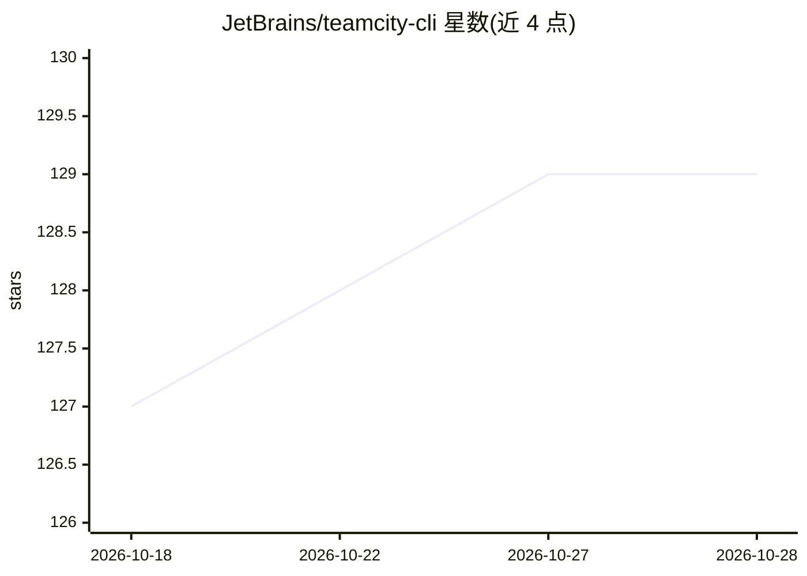

# JetBrains/teamcity-cli

⭐ 129 · Go · Apache-2.0 · 推送 2026-10-27 · [GitHub](https://github.com/JetBrains/teamcity-cli) · [官网](https://jb.gg/tc/docs) · 组织维护

**JetBrains 官方 TeamCity 命令行客户端，含 AI agent 技能**

Go 编写的 TeamCity 官方 CLI，覆盖构建运行与查看、日志跟踪、队列管理、agent 管理与远程 shell、job/project/pipeline 编辑、原始 REST 调用等日常与进阶操作，支持 --json/--plain 脚本化输出与多服务器切换。随 CLI 附带 Agent Skill，可安装到 Claude Code、Cursor 等编码 agent，教会其调用 teamcity 命令。提供 Homebrew、npm、winget、deb/rpm、AUR、Chocolatey、Scoop 及源码构建等多种安装方式。

## 筛选速览

| 维度 | 判定 | 备注 |
|---|---|---|
| AI 角色 | `ai-enhanced` | 去掉 AI 部分产品仍成立 |
| 许可风险 | `permissive` | Apache-2.0 |
| 部署形态 | `desktop` | 安装包/桌面程序 |
| 模型依赖 | — | README 未给出锁定关系 |
| 硬件要求 | — | 无带数字的原话,不猜 |
| 安装摩擦 | `low` | 无编译、无系统依赖或容器化 |
| 成熟度 | — | 结构信号不足 |

## 能力要点

- 覆盖 run/job/project/pipeline/queue/agent/pool 等命令组的完整 CLI
- 内嵌 Agent Skill，可安装给 Claude Code、Cursor 等编码 agent
- teamcity api 直接以存储凭据调用原始 REST API
- TEAMCITY_RO=1 只读模式阻止写入与远程 shell

## 适用场景

- 在终端或脚本中启动构建、跟踪日志、管理 TeamCity 队列
- 让 Claude Code/Cursor 等编码 agent 通过技能驱动 TeamCity
- 在 CI/CD 中以 JSON 输出集成 TeamCity 操作

## 场景标签

 · 领域:开发工具/CI-CD

## 证据(README 行号)

> L5: `teamcity` is the official command-line client for TeamCity. It covers the day-to-day — starting builds, tailing log
> L135: The CLI ships with an Agent Skill that teaches coding agents (Claude Code, Cursor, and others) how to drive `teamc

## 星数曲线

2026-10-18 127 → 2026-10-28 129（+2）

---
*卡片 v1 · prompt 1.4 · 生成 2026-10-23 · 置信度 high · 依据 README sha `5e614b1e2629` · [字段定义](../../DATASET.md)*
