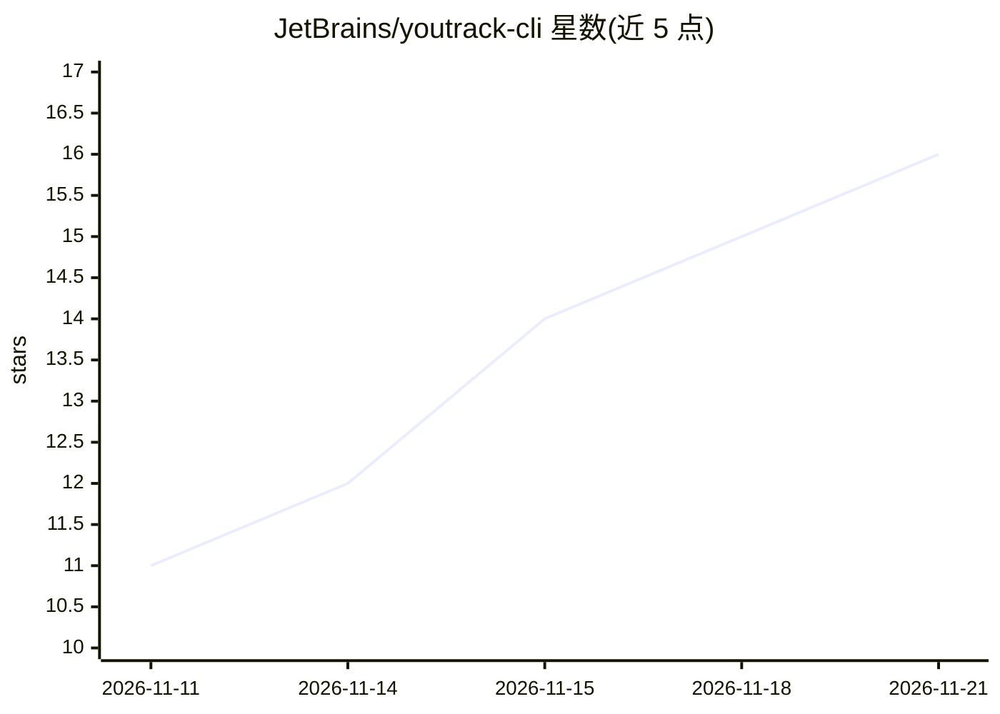

# JetBrains/youtrack-cli

⭐ 16 · Go · NOASSERTION · 推送 2026-11-20 · [GitHub](https://github.com/JetBrains/youtrack-cli) · 组织维护

**YouTrack 官方命令行客户端，供终端用户与 AI agent 驱动项目管理**

JetBrains 官方维护的 YouTrack 命令行客户端，用 Go 编写，覆盖 issue 增删改查、命令执行、项目/用户/角色管理、知识库文章、敏捷看板与冲刺、甘特图、管理设置，以及 youtrack raw 直接调用任意 REST 端点。所有命令支持 --json/--plain 输出以便脚本化。面向终端用户与在流水线中操作 YouTrack 的 AI agent：内置 Agent Skill 安装机制（skill install/guide），支持 Claude Code、Cursor 等编码 agent；YOUTRACK_RO=1 可在客户端层阻断所有写操作，token 输出默认脱敏。需注意 YouTrack 不支持细粒度 token 作用域，任何 token 均为全账户权限。提供安装脚本、Homebrew、Winget、Chocolatey、Scoop、deb/rpm 及 go install 等多种安装方式。

## 筛选速览

| 维度 | 判定 | 备注 |
|---|---|---|
| AI 角色 | `ai-enhanced` | 去掉 AI 部分产品仍成立 |
| 许可风险 | `none` | NOASSERTION |
| 部署形态 | `desktop` | 安装包/桌面程序 |
| 模型依赖 | — | README 未给出锁定关系 |
| 硬件要求 | — | 无带数字的原话,不猜 |
| 安装摩擦 | `low` | 无编译、无系统依赖或容器化 |
| 成熟度 | — | 结构信号不足 |

## 能力要点

- 覆盖 issue/项目/用户/看板/知识库/管理等约 25 组命令，raw 组可直连任意 REST 端点
- 内置 Agent Skill：youtrack skill install/guide 教编码 agent 驱动 CLI
- YOUTRACK_RO=1 客户端层只读保护，面向 AI agent 与 CI 场景
- 全命令 --json/--plain 输出与 --fields 字段投影，支持多实例切换

## 适用场景

- 在终端管理 YouTrack 的 issue、看板与知识库文章
- 让 Claude Code 等编码 agent 通过技能直接操作 YouTrack 工作流
- CI 流水线中以 JSON 输出读取或校验 YouTrack 数据

## 场景标签

 · 领域:项目管理/开发者工具

## 证据(README 行号)

> L5: Command-line client for YouTrack, covering the day-to-day — issues, commands, projects, users — plus the odd jobs: k
> L142: ## For AI agents
> L144: The CLI ships with an Agent Skill that teaches coding agents (Claude Code, Cursor, and others) how to drive `youtr

## 星数曲线

2026-11-11 11 → 2026-11-21 16（+5）

---
*卡片 v1 · prompt 1.4 · 生成 2026-11-18 · 置信度 high · 依据 README sha `a4ee47bd8f62` · [字段定义](../../DATASET.md)*
