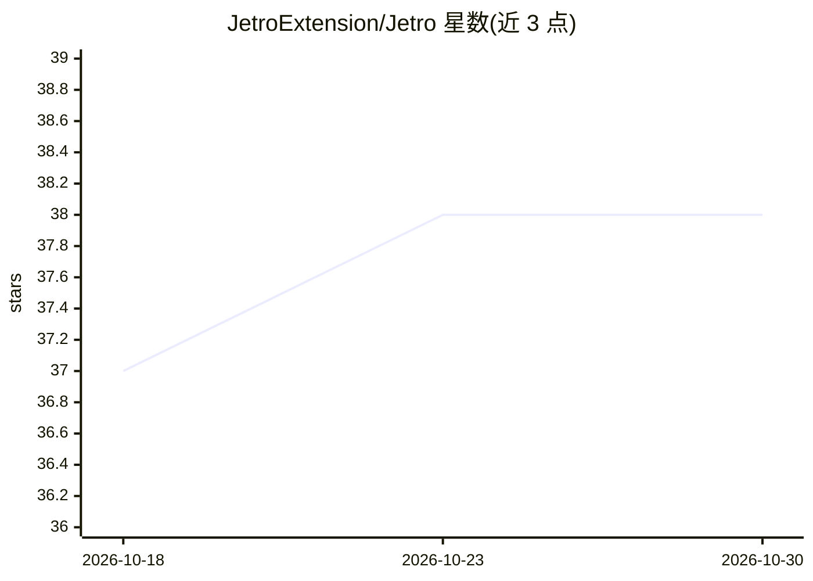

# JetroExtension/Jetro

⭐ 38 · TypeScript · MIT · 推送 2026-04-16 · [GitHub](https://github.com/JetroExtension/Jetro) · [官网](https://jetro.ai) · 组织维护

**给 AI 编程 Agent 提供无限可视化画布的 VS Code 扩展**

开源 VS Code 扩展，为 MCP 兼容的 AI 编程 Agent（Claude Code、Cursor、Copilot、Cline、Windsurf、Qwen 等）提供可视化画布层：Agent 通过 MCP 工具（jet_render、jet_query、jet_exec、jet_parse 等 13 个）向画布渲染图表、表格、iframe 与仪表盘。内置 Plotly.js、DuckDB SQL 查询、CSV/Excel/Parquet 导入、PDF/DOCX 等文档解析、Python/R 沙箱执行与 Docker 部署。默认 dev 模式无需后端与登录；分享与数据 API 代理需自建后端。另提供托管版 jetro.ai。

## 筛选速览

| 维度 | 判定 | 备注 |
|---|---|---|
| AI 角色 | `ai-ecosystem` | LLM/agent 周边工具 |
| 许可风险 | `permissive` | MIT |
| 部署形态 | `self-host` | docker 或自建部署 |
| 模型依赖 | — | README 未给出锁定关系 |
| 硬件要求 | — | 无带数字的原话,不猜 |
| 安装摩擦 | `low` | 无编译、无系统依赖或容器化 |
| 成熟度 | — | 结构信号不足 |

## 能力要点

- 13 个 MCP 工具供 Agent 渲染画布、查询数据、执行代码与解析文档
- 内置 Plotly.js 图表、DuckDB SQL 查询与 Python/R 沙箱执行
- 支持自定义 skills/templates/system prompt 注入 Agent
- dev 模式本地全功能运行，无需后端与注册

## 适用场景

- 让 Claude Code/Cursor 等 Agent 把分析与数据结果渲染到画布
- 构建实时刷新的数据仪表盘与交互式 frame
- 导入多格式数据并用 SQL 查询后由 Agent 可视化

## 场景标签

`数据分析` `文档解析` · 领域:效率与自动化

## 证据(README 行号)

> L5: Jetro is an open-source VS Code extension that adds a living canvas to your editor. Your AI agent can render charts,
> L14: - **MCP Integration** — works with any MCP-compatible agent (Claude Code, Cursor, Copilot, Cline, Windsurf, Qwen, e
> L103: |`npm run build:mcp`|MCP server (tool handlers for agents)|`mcp-server/out/index.js`|

## 星数曲线

2026-10-18 37 → 2026-10-30 38（+1）

---
*卡片 v1 · prompt 1.4 · 生成 2026-10-25 · 置信度 mid · 依据 README sha `37aacb311495` · [字段定义](../../DATASET.md)*
