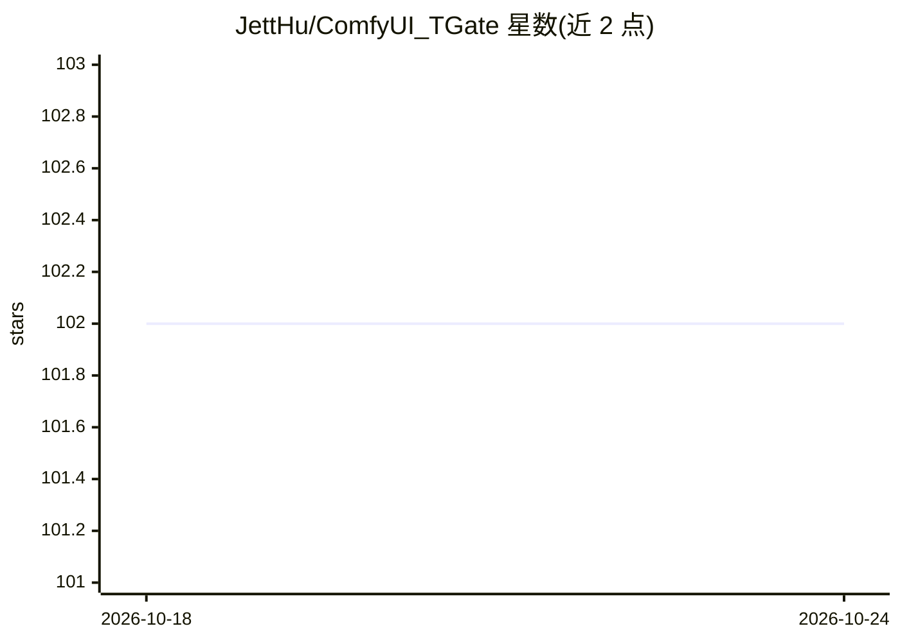

# JettHu/ComfyUI_TGate

⭐ 102 · Python · GPL-3.0 · 推送 2026-01-06 · [GitHub](https://github.com/JettHu/ComfyUI_TGate) · 个人维护 · 中文 README

**给 ComfyUI 用户的 T-GATE 加速插件：为扩散模型生成提速 10%-50%**

T-GATE 算法在 ComfyUI 中的节点化实现：通过缓存 cross-attention 输出减少计算量，为 SD-1.5/SD-2.1/SD-XL/Pixart-Alpha 等扩散模型带来 10%-50% 生成提速，训练无关、保持原始构图，图像质量略有下降。提供 TGate Apply 与 Advanced 两个节点，可配置缓存起始步、仅缓存 cross-attention、use_cpu_cache 缓解 GPU OOM；支持 CNN U-Net、Transformer 与 Consistency Model。安装方式为 git clone 到 ComfyUI 插件目录。当前实现使用 monkey patch，旧版节点已标记废弃。

## 筛选速览

| 维度 | 判定 | 备注 |
|---|---|---|
| AI 角色 | `ai-ecosystem` | LLM/agent 周边工具 |
| 许可风险 | `viral` | GPL-3.0 |
| 部署形态 | `None` |  |
| 模型依赖 | — | README 未给出锁定关系 |
| 硬件要求 | — | 无带数字的原话,不猜 |
| 安装摩擦 | `low` | 无编译、无系统依赖或容器化 |
| 成熟度 | — | 结构信号不足 |

## 能力要点

- T-GATE 加速扩散模型采样，官方数据 10%-50% 提速
- 免训练，保持原始构图，支持 SD/Pixart/LCM 等
- 提供简单节点与高级节点，可配置缓存策略
- use_cpu_cache 选项缓解多批次（animatediff）GPU OOM

## 适用场景

- 在 ComfyUI 工作流中加速 SD-XL 等扩散模型出图
- animatediff 多批次生成时缓解显存溢出
- 在保持构图的前提下降低采样延迟

## 场景标签

`图像生成` · 领域:内容生成

## 证据(README 行号)

> L5: ComfyUI reference implementation for T-GATE.
> L72: ### TGate Apply

## 星数曲线

2026-10-18 102 → 2026-10-24 102（+0）

---
*卡片 v1 · prompt 1.4 · 生成 2026-10-23 · 置信度 high · 依据 README sha `edd1dec45e6c` · [字段定义](../../DATASET.md)*
