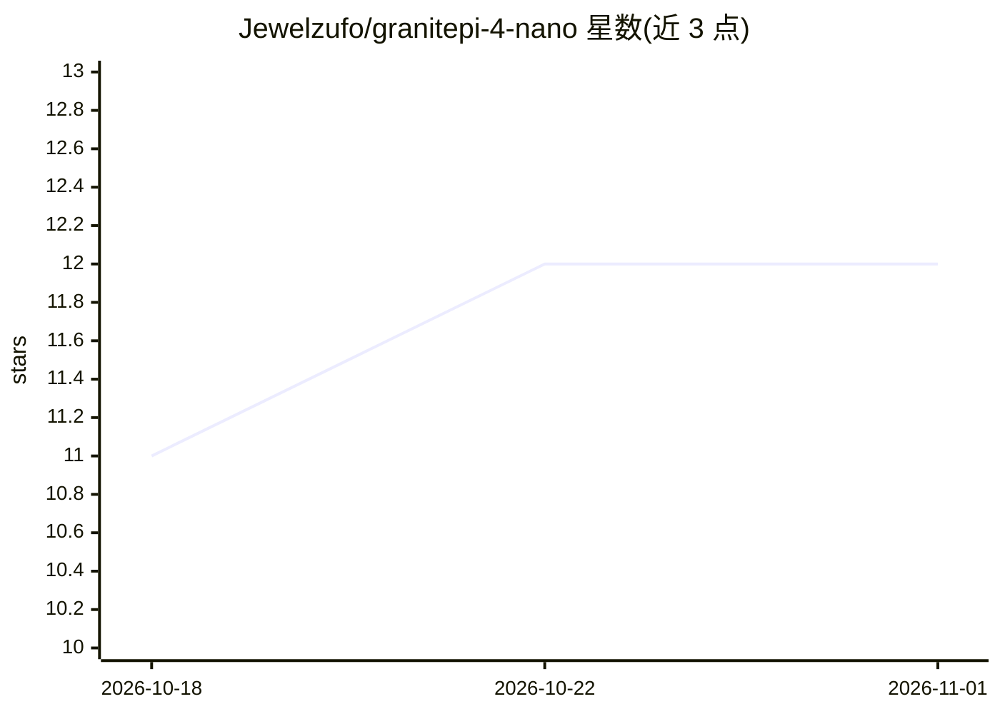

# Jewelzufo/granitepi-4-nano

⭐ 12 · Shell · Apache-2.0 · 推送 2026-10-09 · [GitHub](https://github.com/Jewelzufo/granitepi-4-nano) · 个人维护

**在树莓派 5 上用 Ollama 本地运行 IBM Granite 4.0 的指南**

面向初学者的部署教程仓库：指导在 Raspberry Pi 5 上通过 Ollama 运行 IBM Granite 4.0（350M，Mamba-2 混合架构）的 GGUF 量化版本，实现 100% 本地离线推理。提供自动化 setup.sh 脚本，负责硬件校验、2GB swap 配置、Ollama 安装、性能参数（2 线程/24h keep-alive）与模型下载。硬件要求为 Pi 5、建议 8GB RAM、5GB 空间、主动散热；模型加载后约 1.2GB 内存，实测吞吐 30-50 tokens/sec。含 Python API 集成示例与故障排查。

## 筛选速览

| 维度 | 判定 | 备注 |
|---|---|---|
| AI 角色 | `ai-knowledge` | 知识聚合/清单类 |
| 许可风险 | `permissive` | Apache-2.0 |
| 部署形态 | `None` |  |
| 模型依赖 | local-ok | 支持本地模型 |
| 硬件要求 | — | 无带数字的原话,不猜 |
| 安装摩擦 | `low` | 无编译、无系统依赖或容器化 |
| 成熟度 | — | 结构信号不足 |

## 能力要点

- 自动化 setup.sh 完成硬件校验、Ollama 安装与模型下载
- 350M Granite 4.0 GGUF 量化版，占用约 1.2GB 内存
- 初始安装后可完全离线运行，无需账号
- 提供命令行与 Python（Ollama API）两种使用方式

## 适用场景

- 在树莓派上搭建离线私有 LLM 工作站
- 学习边缘设备上的本地模型部署
- 隐私敏感场景下不联网运行语言模型

## 场景标签

`教程课程` · 领域:学习与行业

## 证据(README 行号)

> L17: This repository contains a complete, beginner-friendly guide to setting up **IBM Granite 4.0 (350M)** on a Raspberr
> L21: - 🔒 **100% Private** — All data stays on your device. No cloud, no tracking.

## 星数曲线

2026-10-18 11 → 2026-11-01 12（+1）

---
*卡片 v1 · prompt 1.4 · 生成 2026-11-01 · 置信度 high · 依据 README sha `982ba6090be0` · [字段定义](../../DATASET.md)*
