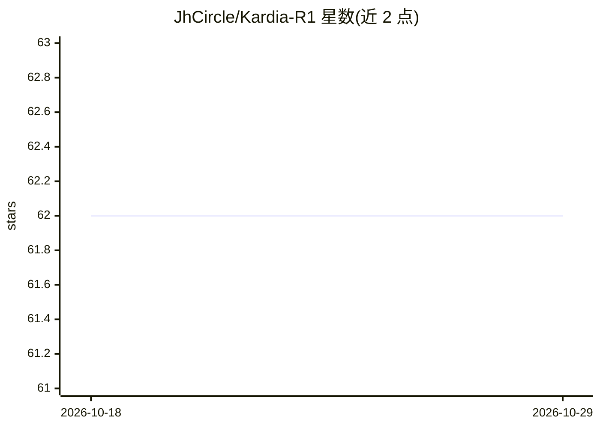

# JhCircle/Kardia-R1

⭐ 62 · Python · MIT · 推送 2026-03-02 · [GitHub](https://github.com/JhCircle/Kardia-R1) · [官网](https://arxiv.org/pdf/2512.01282) · 组织维护

**面向情感支持的共情推理对话模型与数据集框架（WWW 2026）**

Kardia-R1 是推理中心的共情对话框架，统一用户理解、情感推理与支持性回复三个环节，采用 Rubric-as-Judge GRPO 强化学习训练，以可解释的评分规则（相关性、共情、人设一致性、安全性、流畅性）替代黑盒奖励模型。模型输出四段结构化认知（understanding/reasoning/emotion/response）。附带 KardiaBench 数据集：22,080 条多轮对话、671 个用户画像，需在 HuggingFace 提交访问申请。7B 模型已发布，支持 Qwen/Gemma 骨干，通过 transformers 与 ms-swift 推理，需 GPU。

## 筛选速览

| 维度 | 判定 | 备注 |
|---|---|---|
| AI 角色 | `ai-native` | 本体是模型或模型工具 |
| 许可风险 | `permissive` | MIT |
| 部署形态 | `library` | 以包/库形式分发 |
| 模型依赖 | — | README 未给出锁定关系 |
| 硬件要求 | — | 无带数字的原话,不猜 |
| 安装摩擦 | `low` | 无编译、无系统依赖或容器化 |
| 成熟度 | — | 结构信号不足 |

## 能力要点

- 四段结构化认知输出（理解/推理/情绪/回复）
- Rubric-as-Judge GRPO 可验证强化学习，无黑盒奖励模型
- KardiaBench 数据集：22,080 条多轮对话、671 个画像
- 骨干无关，支持 Qwen (3B/7B) 与 Gemma (2B/7B)

## 适用场景

- 我做心理/情感支持对话系统时用该模型生成共情回复
- 获取大规模带人设的多轮共情对话数据做研究
- 复现或扩展 Rubric-as-Judge 强化学习训练方法

## 场景标签

`强化学习` · 领域:训练与推理

## 证据(README 行号)

> L26: > 🧠 **Kardia-R1** is a reasoning-centric empathetic dialogue framework that unifies
> L37:  - `<|response_begin|>...<|response_end|>` — Generate supportive, persona-aligned empathetic replies

## 星数曲线

2026-10-18 62 → 2026-10-29 62（+0）

---
*卡片 v1 · prompt 1.4 · 生成 2026-10-24 · 置信度 high · 依据 README sha `5be221af6579` · [字段定义](../../DATASET.md)*
