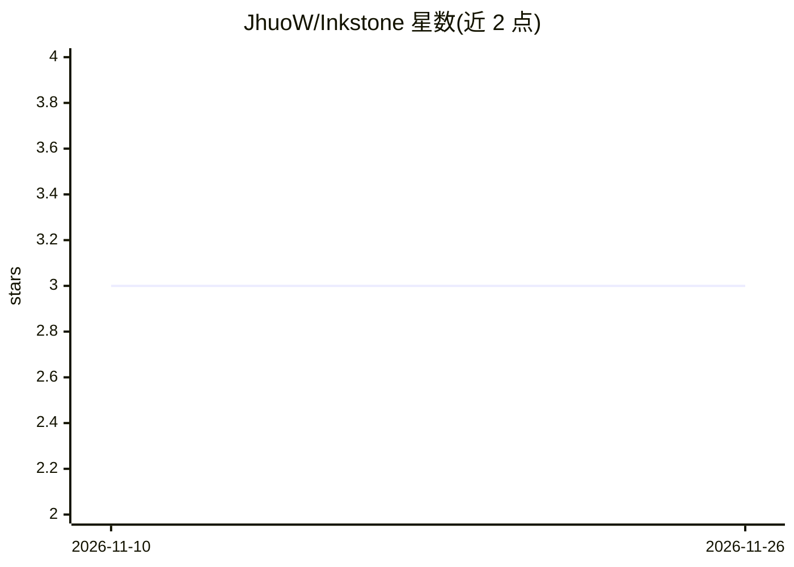

# JhuoW/Inkstone

⭐ 3 · HTML · AGPL-3.0 · 推送 2026-11-10 · [GitHub](https://github.com/JhuoW/Inkstone) · [官网](https://wei2hu0.github.io/inkstone-website/) · 个人维护 · 中文 README

**面向专注写作的本地 Markdown 编辑器，带 AI 分析与修改建议**

Inkstone 是一款本地运行的 Markdown 编辑器，笔记以普通文件形式保存在本机。核心机制包括：AI 写作助手可对文档整体打分、按维度反馈并给出修改建议，且每处修改需用户审阅后才接受；支持 11 个模型服务商（含本地模型）的接入、模型发现与对话。编辑器本身提供实时预览、LaTeX 公式、Mermaid 图、代码块、本地文件夹管理与 PDF/HTML/Word 导出。支持 Windows 与 Linux，自带更新机制；安装包尚未代码签名。

## 筛选速览

| 维度 | 判定 | 备注 |
|---|---|---|
| AI 角色 | `ai-enhanced` | 去掉 AI 部分产品仍成立 |
| 许可风险 | `viral` | AGPL-3.0 |
| 部署形态 | `desktop` | 安装包/桌面程序 |
| 模型依赖 | locked-api |  |
| 硬件要求 | — | 无带数字的原话,不猜 |
| 安装摩擦 | `low` | 无编译、无系统依赖或容器化 |
| 成熟度 | — | 结构信号不足 |

## 能力要点

- AI 写作助手：文档评分、逐维度反馈与需审阅的修改建议
- 11 个模型服务商可选，含本地模型、OpenAI、Claude、Gemini、DeepSeek
- 支持 LaTeX 公式、Mermaid 图、语法高亮代码块与表格编辑
- 导出 PDF/HTML/图片，配合 Pandoc 可导出 Word

## 适用场景

- 在本地以普通文件形式管理 Markdown 笔记并专注写作
- 让 AI 对文档打分并逐条审阅修改建议
- 需要数学公式、Mermaid 图与代码块的文档撰写
- 将 Markdown 导出为 PDF、HTML 或 Word

## 场景标签

`AI 写作` · 领域:内容生成

## 证据(README 行号)

> L7: Inkstone is an **AI-powered local Markdown editor** for focused writing, with LLM-based document analysis, scoring, 
> L22: - AI Writing Assistant: 11 provider choices including local models, OpenAI, Claude, Gemini and DeepSeek; model disc

## 星数曲线

2026-11-10 3 → 2026-11-26 3（+0）

---
*卡片 v1 · prompt 1.4 · 生成 2026-11-22 · 置信度 high · 依据 README sha `5f4f563b0ea5` · [字段定义](../../DATASET.md)*
