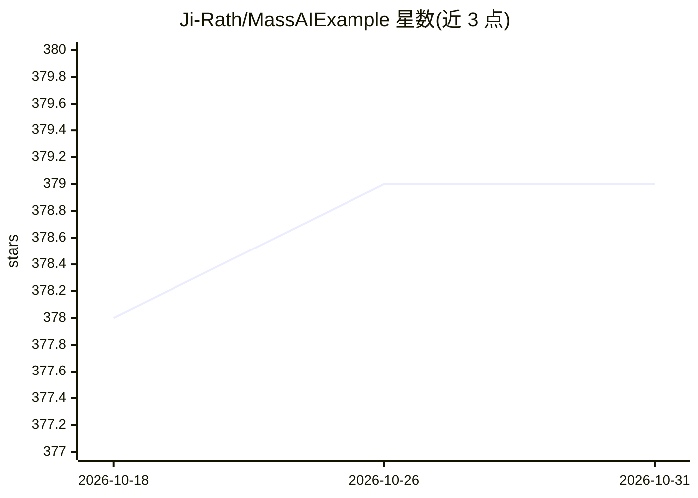

# Ji-Rath/MassAIExample

⭐ 379 · C++ · MIT · 推送 2026-08-13 · [GitHub](https://github.com/Ji-Rath/MassAIExample) · 个人维护

**UE5 Mass ECS 框架的 AI 示例与实验项目集合**

面向 Unreal Engine 5 开发者的 Mass（ECS 框架）实验工程，包含多个示例：开放模拟（采集资源建房）、Niagara 可视化（约 5 万实体、3 级 LOD 顶点动画）、导航寻路、存档系统、Smart Object 交互、漫游 AI、空间哈希网格、State Tree 与弹幕示例。另附研究笔记，记录 Mass/StateTree/SmartObject/City Sample 的机制发现与踩坑。README 未给出安装运行命令，需从仓库源码与 UE5 工程自行使用。

## 筛选速览

| 维度 | 判定 | 备注 |
|---|---|---|
| AI 角色 | `ai-knowledge` | 知识聚合/清单类 |
| 许可风险 | `permissive` | MIT |
| 部署形态 | `None` |  |
| 模型依赖 | — | README 未给出锁定关系 |
| 硬件要求 | — | 无带数字的原话,不猜 |
| 安装摩擦 | `low` | 无编译、无系统依赖或容器化 |
| 成熟度 | — | 结构信号不足 |

## 能力要点

- 约 5 万 Mass 实体的 Niagara 可视化（3 级 LOD：顶点动画/公告板）
- 采集资源建房的开模拟示例（Smart Object 查询 + State Tree 管理 AI 逻辑）
- 空间哈希网格示例（用于快速范围查询，与 Mass avoidance 同底层）
- Mass/StateTree/SmartObject 机制研究笔记与已知问题记录

## 适用场景

- 学习 UE5 Mass ECS 与 State Tree 的组织方式
- 参考大规模实体可视化与顶点动画 LOD 方案
- 查 Mass/SmartObject 集成的实验性发现与坑点

## 场景标签

`教程课程` · 领域:学习与行业

## 证据(README 行号)

> L7:  A project primarily used to experiment with Mass, an ECS Framework
> L83: # Research
> L84: These are my rough notes outlining discoveries made within mass and the city sample. Please don't expect anything w

## 星数曲线

2026-10-18 378 → 2026-10-31 379（+1）

---
*卡片 v1 · prompt 1.4 · 生成 2026-10-21 · 置信度 mid · 依据 README sha `388bef1d09bc` · [字段定义](../../DATASET.md)*
