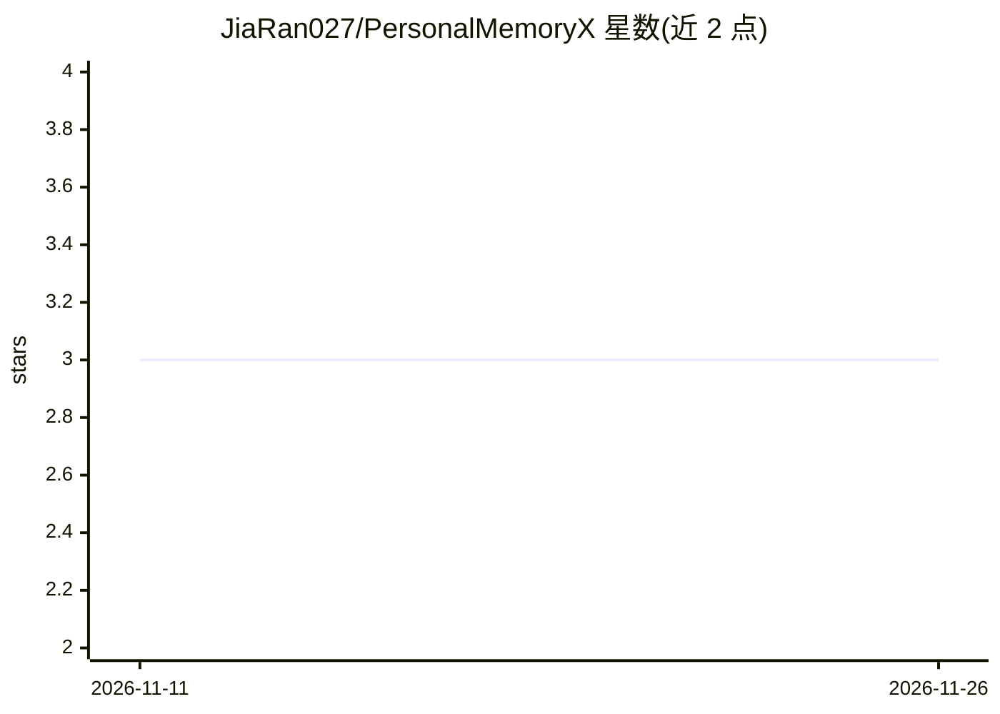

# JiaRan027/PersonalMemoryX

⭐ — · [GitHub]() · 个人维护 · 中文 README

**本地优先的 AI Agent 跨会话记忆基础设施**

PersonalMemory 是本地优先、用户掌控的 AI 记忆系统：从授权的对话来源中按规则筛选值得留下的记忆线索，保留来源证据与修订过程，用户可查看、纠正、删除，并通过 MCP 在任务需要时向 Agent 召回受预算限制的相关记忆。记忆库存于本机，不提供云同步与账号体系；Claude Code、Codex 等通过 Hook 接入作为输入与召回入口。当前为 Windows Alpha 版，发布 AGPL-3.0-or-later 许可。

## 筛选速览

| 维度 | 判定 | 备注 |
|---|---|---|
| AI 角色 | `ai-ecosystem` | LLM/agent 周边工具 |
| 许可风险 | `viral` | — |
| 部署形态 | `desktop` | 安装包/桌面程序 |
| 模型依赖 | — | README 未给出锁定关系 |
| 硬件要求 | — | 无带数字的原话,不猜 |
| 安装摩擦 | `low` | 无编译、无系统依赖或容器化 |
| 成熟度 | `idea` | |

## 能力要点

- 自动采集：Claude Code 与 Codex 的 Hook 路径选择性处理对话
- 通过 MCP 按任务获取受预算限制的相关记忆
- 记忆保留来源证据与修订过程，支持纠正与删除
- `.pmemory` 实验性格式的导入/导出

## 适用场景

- 让多个 Agent 共享同一份本地记忆库
- 审查并修正 AI 自动沉淀的记忆内容
- 避免对话记忆被锁定在某一家 Agent 账号下

## 场景标签

`Agent 记忆` · 领域:Agent 开发

## 证据(README 行号)

> L9: PersonalMemory 是一个**本地优先、由用户掌控的 AI 记忆系统**。它关注的不是保存整段聊天，而是从获准的来源中筛选值得留下的内容，保留记忆的来源与变化，并在相关情境中按需召回。
> L11: 核心是记忆如何形成、关联、修订和被唤起；Claude Code、Codex 等 Agent 只是当前的输入与召回入口。跨 Agent 使用是用户拥有记忆后带来的能力，不是产品目标的全部。
> L28: - **按需召回：**MCP 根据当前任务编译有限上下文，不会默认把整个记忆库塞给 Agent。

## 星数曲线

2026-11-11 3 → 2026-11-26 3（+0）

---
*卡片 v1 · prompt 1.4 · 生成 2026-11-22 · 置信度 high · 依据 README sha `aaec31427a19` · [字段定义](../../DATASET.md)*
