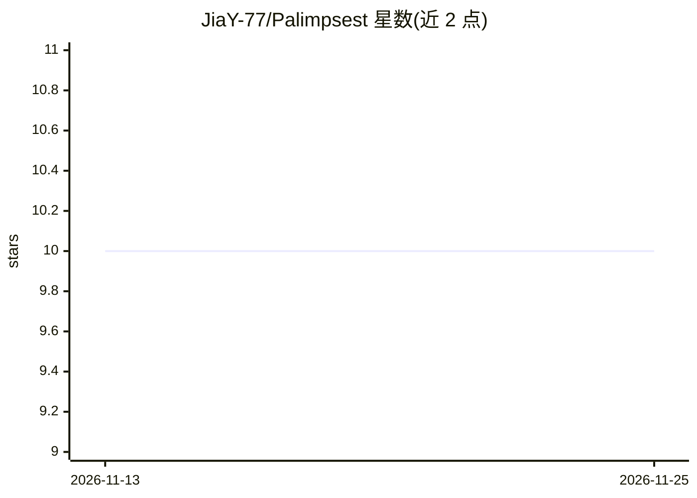

# JiaY-77/Palimpsest

⭐ 10 · Python · MIT · 推送 2026-11-14 · [GitHub](https://github.com/JiaY-77/Palimpsest) · [官网](https://github.com/JiaY-77/Palimpsest) · 个人维护 · 中文 README

**给 AI agent 用的本地记忆库：向量+全文+图谱检索**

本地优先的个人记忆库，由记忆内核（存储/检索/版本链/域隔离）与场景化领域包组成；AI 会话要点写成节点存入本机数据库，跨会话按语义召回。提供向量（内置 GGUF 模型）+ FTS5 + RRF 融合检索、加权图扩散、显式取代与 bi-temporal 版本链。接入面为 MCP/REST/CLI 同一进程，REST :8090 为唯一写者，单库单写进程；数据为一个目录可整组备份。无 API key 可离线运行，LLM 仅生成报告时可选。

## 筛选速览

| 维度 | 判定 | 备注 |
|---|---|---|
| AI 角色 | `ai-ecosystem` | LLM/agent 周边工具 |
| 许可风险 | `permissive` | MIT |
| 部署形态 | `self-host` | docker 或自建部署 |
| 模型依赖 | local-ok | 支持本地模型 |
| 硬件要求 | — | 无带数字的原话,不猜 |
| 安装摩擦 | `low` | 无编译、无系统依赖或容器化 |
| 成熟度 | — | 结构信号不足 |

## 能力要点

- 向量 + FTS5 + RRF 融合检索与加权图 BFS 扩散、Leiden 社区
- 显式取代 + REVISED_BY 版本链 + bi-temporal 双时间，不静默覆盖
- MCP / REST / CLI 指向同一进程同一套工具，多客户端可同时接入
- 零 API key、内置 GGUF 向量引擎，数据目录整组可搬

## 适用场景

- 让 agent 跨会话记住此前讨论过的架构与决策
- 角色扮演、跑团主持设定按 domain 分区互不串味
- 把 Obsidian Markdown 知识库切片入库并建图谱
- 长任务收尾写接续点，新会话直接带出上下文

## 场景标签

`Agent 记忆` `知识图谱` · 领域:Agent 开发

## 证据(README 行号)

> L22: 一个**可领域适配的个人记忆库**：**记忆内核**（存储 / 检索 / 版本链 / 隔离）+ **领域包**（每个场景一套写入与注入规则）。同一个底座，角色扮演、跑团主持、个人知识、自用助手各自一套规则——不追求通用，追求在具体
> L26: - **不需要 API key 就能跑。** 存储、检索、图谱、版本链全部本地完成；LLM 只在生成报告时用到，可以完全不配。
> L130: > 接入面是标准协议：MCP（stdio / streamable-http）、REST、CLI 指向同一个进程与同一套底层工具，因此**多个客户端可以同时接入同一座记忆库**；多写入方的一致性规范仍在设计中，当前建议以单一主写

## 星数曲线

2026-11-13 10 → 2026-11-25 10（+0）

---
*卡片 v1 · prompt 1.4 · 生成 2026-11-20 · 置信度 mid · 依据 README sha `e1022576fc7e` · [字段定义](../../DATASET.md)*
