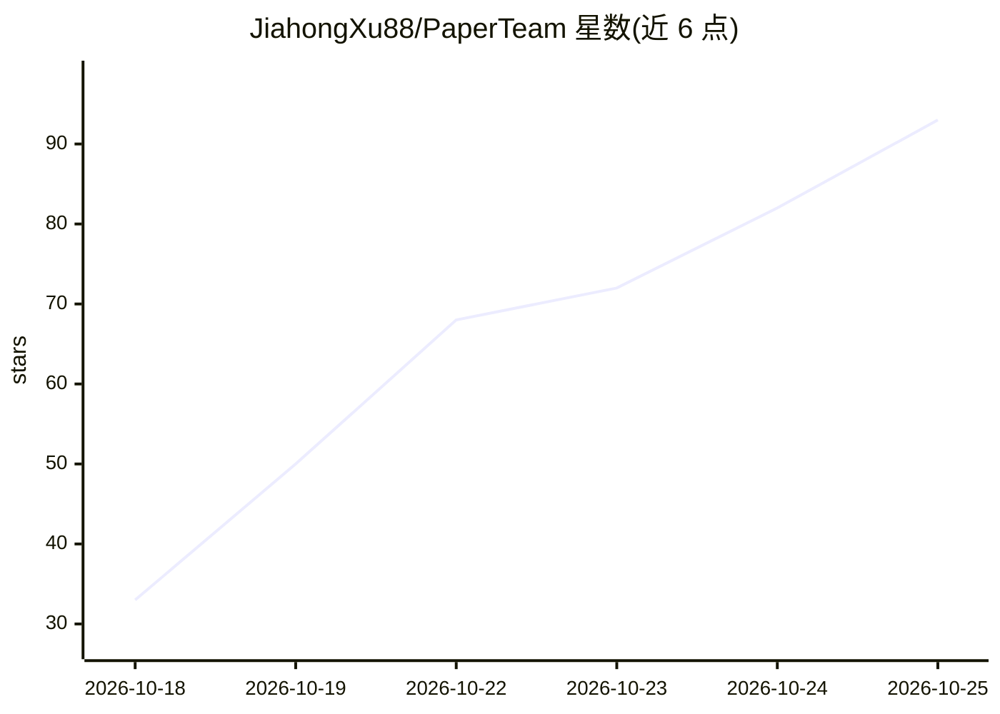

# JiahongXu88/PaperTeam

⭐ 95 · TypeScript · MIT · 推送 2026-10-25 · [GitHub](https://github.com/JiahongXu88/PaperTeam) · 个人维护 · 中文 README

**科研人员的学术论文写作/修订 AI 工作台**

自托管的学术论文工作台（TypeScript Web 应用，前后端分离，Docker 可部署）：从选题生成综述/研究论文，检索真实文献（OpenAlex/Semantic Scholar/arXiv 等）并经引用核验后才可引用；也可导入已有稿件按审稿意见逐条修订，带作用域补丁与事实/引用保全守卫；支持目标期刊基准评审、图表确定性检查与基于真实数据集的矢量图编译。流程控制为确定性代码，LLM 仅运行于各专业 agent 角色，15 个人工决策点暂停等待确认。论文以 xelatex+bibtex 编译为 PDF。

## 筛选速览

| 维度 | 判定 | 备注 |
|---|---|---|
| AI 角色 | `ai-native` | 本体是模型或模型工具 |
| 许可风险 | `permissive` | MIT |
| 部署形态 | `self-host` | docker 或自建部署 |
| 模型依赖 | — | README 未给出锁定关系 |
| 硬件要求 | — | 无带数字的原话,不猜 |
| 安装摩擦 | `low` | 无编译、无系统依赖或容器化 |
| 成熟度 | `idea` | |

## 能力要点

- 证据三级校验（retrieved≠verified≠grounded），仅核验证据可被引用
- 17+ 确定性质量门与引用完整性检查，流程控制为确定性 TypeScript 而非 LLM
- 按审稿意见逐条修订，补丁经作用域/事实/引用/证据机器校验
- 从真实数据集（CSV/XLSX/JSON）确定性生成 pgfplots/TikZ 矢量图

## 适用场景

- 从研究想法出发走完大纲→写作→引用核验→评审→修订→PDF 全流程
- 导入已有论文和审稿意见，逐条修订且不破坏事实与引用
- 生成缺乏实验数据的论文时只产出实验计划而非编造结果
- 按目标期刊做质量基准评审与图表一致性检查

## 场景标签

`科研工具` `AI 写作` · 领域:内容生成

## 证据(README 行号)

> L6: **PaperTeam is a self-hosted AI workbench for academic writing.** It searches real
> L30: Pick **Create a new paper**, choose a paper type, and PaperTeam runs the full loop:
> L32: - **Survey / review paper** — enter just a topic. PaperTeam plans the research,

## 星数曲线

2026-10-18 33 → 2026-10-25 93（+60）

---
*卡片 v1 · prompt 1.4 · 生成 2026-10-24 · 置信度 mid · 依据 README sha `33551e948902` · [字段定义](../../DATASET.md)*
