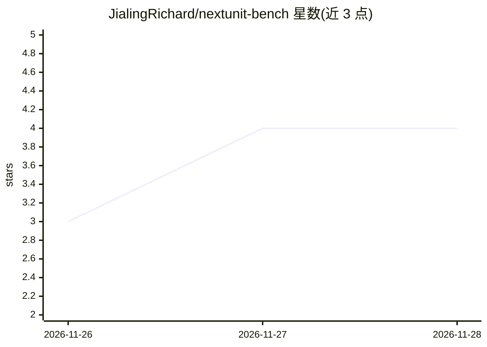

# JialingRichard/nextunit-bench

⭐ 4 · Python · MIT · 推送 2026-11-20 · [GitHub](https://github.com/JialingRichard/nextunit-bench) · 组织维护

**面向 LLM coding agent 的 PHM 部署式基准（24 数据集）**

预测性健康管理（PHM）领域的 agent 评测基准：将 24 个公开数据集切分为 58 个留出折（留出设备单元或工况），被评测的 agent 在沙箱内两小时内交付可执行的 predictor 工件，评估器在沙箱外对隐藏单元离线运行并打分。仓库包含冻结的基准定义、数据获取与校验脚本、评估器、自检与最小 agent runner；不含任何数据集，数据从原始来源下载并以 SHA-256 校验。要求 Linux x86_64、用户命名空间与 systemd-run，磁盘约 260 GB。

## 筛选速览

| 维度 | 判定 | 备注 |
|---|---|---|
| AI 角色 | `ai-knowledge` | 知识聚合/清单类 |
| 许可风险 | `permissive` | MIT |
| 部署形态 | `None` |  |
| 模型依赖 | — | README 未给出锁定关系 |
| 硬件要求 | — | 无带数字的原话,不猜 |
| 安装摩擦 | `low` | 无编译、无系统依赖或容器化 |
| 成熟度 | — | 结构信号不足 |

## 能力要点

- 24 个公开 PHM 数据集、58 个留出折，覆盖轴承/电池/涡扇发动机/风机等
- 部署式协议：agent 两小时交付密封可执行 predictor，评估器离线复跑隐藏单元
- 同一评估器可评测 LLM agent、AutoML、已发表方法或自建流水线
- agent 按领域手册自动完成搭建，无人工安装向导

## 适用场景

- 评测 coding agent 在留出设备数据上构建模型的能力
- 将 AutoML 或自有 PHM 流水线与 LLM agent 在同一评分下对比
- 复现论文中各 agent 的 S24/S_noshortcut 分数

## 场景标签

`编码 Agent` `模型评测` · 领域:编码与开发

## 证据(README 行号)

> L25: Deployment-style evaluation. The agent sees the task description and the development units, works for two hours in 
> L35: - **Any modeler:** LLM agents, AutoML, published methods, or your own pipeline are scored by the same evaluator.
> L92: - Contains: the frozen benchmark definition (task descriptions, splits,

## 星数曲线

2026-11-26 3 → 2026-11-28 4（+1）

---
*卡片 v1 · prompt 1.4 · 生成 2026-11-26 · 置信度 high · 依据 README sha `145ed108aad1` · [字段定义](../../DATASET.md)*
