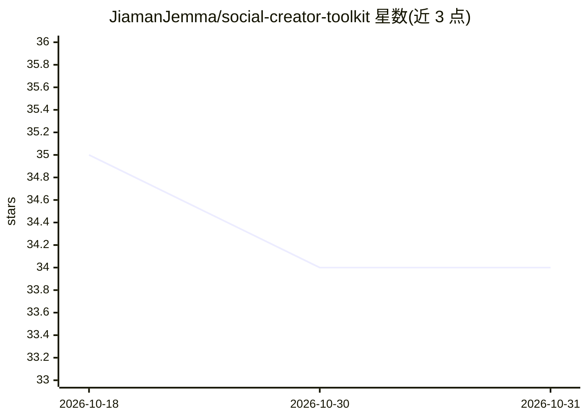

# JiamanJemma/social-creator-toolkit

⭐ 34 · MIT · 推送 2026-03-04 · [GitHub](https://github.com/JiamanJemma/social-creator-toolkit) · [官网](https://jiamanjemma.com) · 个人维护 · 中文 README

**Claude Code 技能：短视频多平台文案与发布策略生成工具包**

面向内容创作者的 Claude Code Skill：通过触发词驱动的工作流，从字幕或视频中生成抖音、B站、小红书、视频号、YouTube 的适配文案，每平台提供 3 个标题选项与封面提示词，并基于历史数据与平台规则推荐发布时间、追踪数据反馈。内置各平台标题字数与标签规则表及 7 个标题公式。可联动 social-auto-upload 实现发布闭环；依赖 Gemini CLI、ffmpeg、whisper、Nano Banana 等外部工具。以 git clone 到 skills 目录方式安装。

## 筛选速览

| 维度 | 判定 | 备注 |
|---|---|---|
| AI 角色 | `ai-native` | 本体是模型或模型工具 |
| 许可风险 | `permissive` | MIT |
| 部署形态 | `None` |  |
| 模型依赖 | — | README 未给出锁定关系 |
| 硬件要求 | — | 无带数字的原话,不猜 |
| 安装摩擦 | `medium` | 含编译或系统依赖之一 |
| 成熟度 | — | 结构信号不足 |

## 能力要点

- 5 个平台一站式文案适配，每平台 3 个标题选项
- 按各平台字数/标签规则生成并推荐发布时间
- 生成 Nano Banana 三种比例封面提示词
- 联动 social-auto-upload 形成创作-发布-数据反馈闭环

## 适用场景

- 一条视频同时生成多平台适配文案和标题
- 基于历史数据选择各平台发布时间
- 生成封面图提示词与封面短标题

## 场景标签

`AI 写作` `图像生成` · 领域:内容生成

## 证据(README 行号)

> L3: Claude Code Skill: 全平台内容发布工具包 — 文案生成 + 封面提示词 + 发布策略 + 数据分析
> L30: 字幕分析 → 主题提取 → 标题生成(x3) → 文案适配 → 封面提示词 → 发布时间推荐 → 输出.md

## 星数曲线

2026-10-18 35 → 2026-10-31 34（-1）

---
*卡片 v1 · prompt 1.4 · 生成 2026-10-25 · 置信度 high · 依据 README sha `a753122de878` · [字段定义](../../DATASET.md)*
