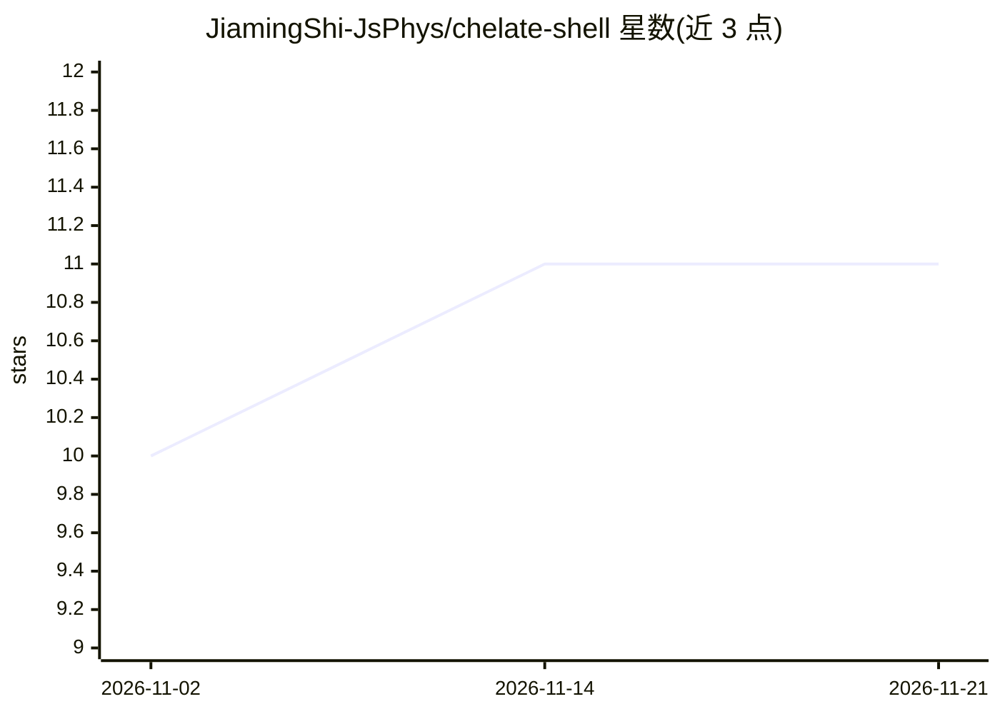

# JiamingShi-JsPhys/chelate-shell

⭐ 11 · Python · MIT · 推送 2026-11-19 · [GitHub](https://github.com/JiamingShi-JsPhys/chelate-shell) · 个人维护 · 中文 README

**把 25 个本地 agent 技能编排为确定性流水线的研究/工程插件**

以插件形式安装到 Claude Code、Codex、Cursor 等 agent 宿主的一套技能集合与编排器：25 个技能各自实现具体算法（SymPy 公式校验、RDKit 化学配平、R 统计、OpenCV 视频跟踪、scikit-learn 数据审计等），core/router.py 按固定阶段顺序路由，每次调用写入带类型的 gate 结果，首个 FAIL 停止流水线。唯一的不可逆步骤（process/ 提升到 results/）需人工审批，签名密钥存于工作区之外。MIT 许可，Python 3.10+。

## 筛选速览

| 维度 | 判定 | 备注 |
|---|---|---|
| AI 角色 | `ai-ecosystem` | LLM/agent 周边工具 |
| 许可风险 | `permissive` | MIT |
| 部署形态 | `library` | 以包/库形式分发 |
| 模型依赖 | — | README 未给出锁定关系 |
| 硬件要求 | — | 无带数字的原话,不猜 |
| 安装摩擦 | `low` | 无编译、无系统依赖或容器化 |
| 成熟度 | — | 结构信号不足 |

## 能力要点

- 25 个技能按确定性阶段顺序路由，同一输入产生同一计划
- 每次调用写入 gate 结果，首个 FAIL 终止并锁定 process/
- 提升到 results/ 需绑定 SHA-256 与 15 分钟有效期的人工审批
- 支持聊天框 / 命令行 / 双注册子 agent 三种调用方式

## 适用场景

- 为科研写作流程串联公式校验、文献审计与 LaTeX 导出
- 在 CI 中以无头模式批量运行数据画像与图表生成
- 需要每次调用留痕、失败即停的可审计 agent 工作流

## 场景标签

`工作流自动化` `科研工具` · 领域:效率与自动化

## 证据(README 行号)

> L5: Each skill solves a single problem. The hard part is what runs first, and where the output lands — Chelate Shell put
> L20: - **The orchestrator guarantees what a lone skill cannot.** `core/router.py` breaks the task down, enforces the fou
> L46: Claude Code, Codex, dsh and CodeBuddy install with a one-line plugin command; Cursor, Windsurf, Cline, Continue, Ro

## 星数曲线

2026-11-02 10 → 2026-11-21 11（+1）

---
*卡片 v1 · prompt 1.4 · 生成 2026-11-19 · 置信度 high · 依据 README sha `b5d3c09d46eb` · [字段定义](../../DATASET.md)*
