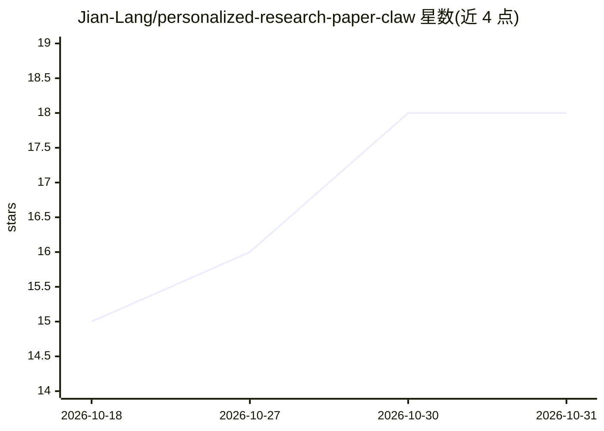

# Jian-Lang/personalized-research-paper-claw

⭐ 18 · Python · Apache-2.0 · 推送 2026-10-29 · [GitHub](https://github.com/Jian-Lang/personalized-research-paper-claw) · [官网](https://jianlang.org/html/research-paper-claw) · 个人维护 · 中文 README

**面向科研者的本地优先论文推荐与笔记系统（Codex/Obsidian）**

本地优先的科研论文工作流系统：内置 NeurIPS/ICML/ICLR/CVPR/ACL/ECCV/EMNLP 等顶会接收清单数据，按用户自定义 topics/keywords/排除词对标题+摘要打分，生成每日推荐页与 Must read/Worth reading/Skip 分级；对用户选定的论文（标题/arXiv/DOI/PDF/Zotero）生成结构化详细笔记，并按领域组织成 Domain Research Gallery，可一键导出独立 HTML 阅读页。运行不联网抓取会议数据，笔记沉淀于 Obsidian。不自动写论文或跑实验。

## 筛选速览

| 维度 | 判定 | 备注 |
|---|---|---|
| AI 角色 | `ai-native` | 本体是模型或模型工具 |
| 许可风险 | `permissive` | Apache-2.0 |
| 部署形态 | `None` |  |
| 模型依赖 | — | README 未给出锁定关系 |
| 硬件要求 | — | 无带数字的原话,不猜 |
| 安装摩擦 | `low` | 无编译、无系统依赖或容器化 |
| 成熟度 | — | 结构信号不足 |

## 能力要点

- 本地内置顶会接收清单，离线打分生成每日推荐与阅读分级
- 关键词打分规则透明（含 score_breakdown）且支持排除词
- 由 arXiv/DOI/PDF/Zotero 等输入生成结构化论文详细笔记
- Domain Research Gallery 组织领域论文关系并可导出 HTML 阅读页

## 适用场景

- 每天早上在 Obsidian 获取符合自己研究方向的顶会论文推荐
- 对选定的论文生成可修订引用的结构化精读笔记
- 按领域组织相关工作的继承/对比/互补关系并导出分享页

## 场景标签

`科研工具` `知识库管理` `推荐系统` · 领域:知识与检索

## 证据(README 行号)

> L5: A local-first research and learning system in which a **Research Agent** proactively advances paper discovery, filte
> L42: - 📬 **Daily Conf Paper Delivery** remembers your fine-grained preferences, finds genuinely worthwhile work in conti
> L55: |**📬 Daily Conf Paper Delivery**|Conferences, topics, keywords, exclusions, and thresholds|Reads acceptance lists, 
> L73: The recommendation page begins with a sharp daily overview and a Must read / Worth reading / Skip triage table. Eac

## 星数曲线

2026-10-18 15 → 2026-10-31 18（+3）

---
*卡片 v1 · prompt 1.4 · 生成 2026-10-30 · 置信度 high · 依据 README sha `423eb2221491` · [字段定义](../../DATASET.md)*
