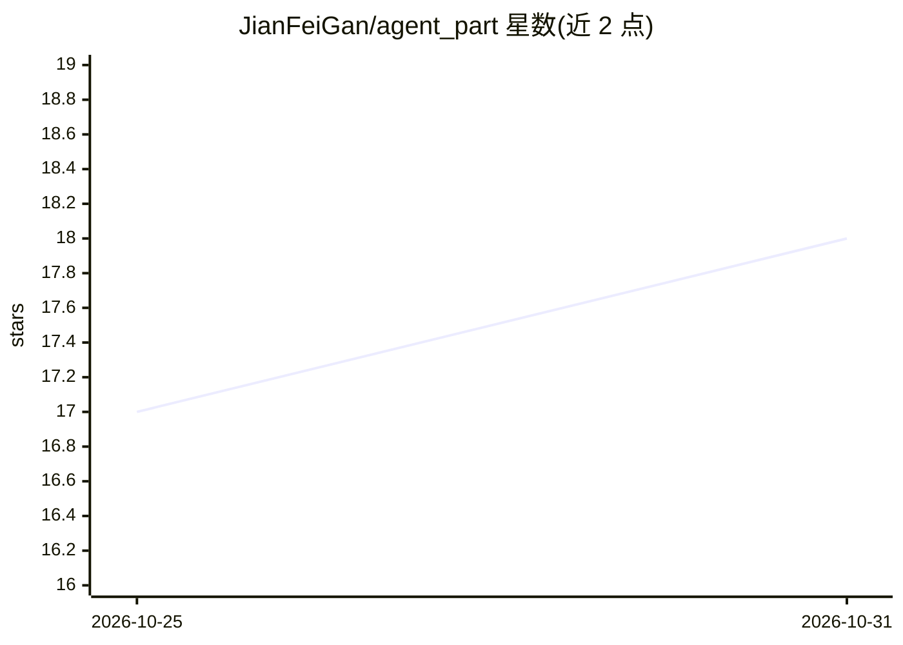

# JianFeiGan/agent_part

⭐ 18 · Python · Apache-2.0 · 推送 2026-10-24 · [GitHub](https://github.com/JianFeiGan/agent_part) · 个人维护 · 中文 README

**跨境电商多 Agent 系统：商品分析到 AI 文案/图/视频生成并刊登**

基于 LangGraph 状态图编排 7+ 个 Agent 的跨境电商应用：商品分析（卖点/竞品/人群）、AI 文案生成、DashScope 万象/SenseNova 图片生成、可灵 AI 视频生成、广告法禁词与平台规则合规检查，最终经 Amazon/eBay/Shopify 适配器刊登；含 PGVector + Graph RAG 知识增强、Token/双币种费用追踪，以及 DevTools 风格可观测工作台（DAG 流程图 + 提示词轨迹 + WebSocket 实时推送）。技术栈为 FastAPI + Vue 3，Docker Compose 部署，需 QWEN_API_KEY，可设 Mock 模式无 Key 体验。

## 筛选速览

| 维度 | 判定 | 备注 |
|---|---|---|
| AI 角色 | `ai-native` | 本体是模型或模型工具 |
| 许可风险 | `permissive` | Apache-2.0 |
| 部署形态 | `self-host` | docker 或自建部署 |
| 模型依赖 | — | README 未给出锁定关系 |
| 硬件要求 | — | 无带数字的原话,不猜 |
| 安装摩擦 | `low` | 无编译、无系统依赖或容器化 |
| 成熟度 | — | 结构信号不足 |

## 能力要点

- LangGraph 编排 7 个视觉生成 Agent + 4 个刊登 Agent + 4 个 RAG Agent
- DAG 流程图 + 提示词/输入输出/子调用详情的可观测工作台，WebSocket 实时更新
- DashScope 万象 / SenseNova 图片生成与可灵 AI 视频生成，LLM 兜底降级链
- Amazon / eBay / Shopify 多平台刊登适配器与多租户 API Token 鉴权

## 适用场景

- 跨境电商卖家自动生成多语言商品文案与图片/视频并刊登到多平台
- AI 应用开发者学习 LangGraph 多 Agent 编排与可观测性实现
- 在无 API Key 的 Mock 模式下体验完整 Agent 工作流

## 场景标签

`多智能体` `AI 写作` `图像生成` `视频生成` · 领域:Agent 开发

## 证据(README 行号)

> L30: Agent Part 是一个面向跨境电商的 **多 Agent 协作系统**，利用 LangGraph 状态图驱动多个专业 Agent 协同工作，自动完成从商品分析到视觉内容生成、合规检查、多平台刊登的全流程。
> L34: - 🖼️ **图片生成** - DashScope 万象 / SenseNova（`wanx-v1` / `sensenova-u1-fast` 等，Provider 可配）
> L35: - 🎬 **视频生成** - 可灵 AI 分镜设计 + 视频生成

## 星数曲线

2026-10-25 17 → 2026-10-31 18（+1）

---
*卡片 v1 · prompt 1.4 · 生成 2026-10-30 · 置信度 high · 依据 README sha `4328e9bf3ae5` · [字段定义](../../DATASET.md)*
