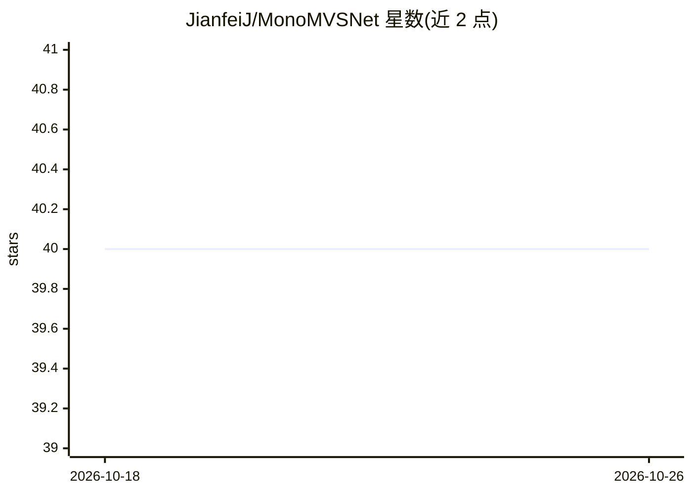

# JianfeiJ/MonoMVSNet

⭐ 40 · Python · MIT · 推送 2025-12-16 · [GitHub](https://github.com/JianfeiJ/MonoMVSNet) · 组织维护

**单目先验引导的多视图立体网络：从多视图图像生成深度图与稠密点云**

ICCV 2025 论文 MonoMVSNet 的官方代码，面向三维重建与多视图立体（MVS）研究者。网络将单目基础模型的特征与深度先验融入多视图几何：通过跨视图位置编码的注意力机制把参考视图单目特征整合进源视图特征，用对齐后的单目深度动态更新边缘区域的深度候选，并以相对一致性损失监督深度预测。支持在 DTU 与 BlendedMVS 上训练、在 DTU 与 Tanks-and-Temples 上测试，需下载 Depth Anything V2 与 TEED 预训练权重并配置 conda 环境（Python 3.10.8），复现论文显存占用需安装 xformers。

## 筛选速览

| 维度 | 判定 | 备注 |
|---|---|---|
| AI 角色 | `ai-native` | 本体是模型或模型工具 |
| 许可风险 | `permissive` | MIT |
| 部署形态 | `library` | 以包/库形式分发 |
| 模型依赖 | — | README 未给出锁定关系 |
| 硬件要求 | — | 无带数字的原话,不猜 |
| 安装摩擦 | `low` | 无编译、无系统依赖或容器化 |
| 成熟度 | — | 结构信号不足 |

## 能力要点

- 跨视图位置编码的注意力机制整合单目特征
- 单目深度对齐动态更新深度候选并用于相对一致性损失监督
- 提供 DTU / BlendedMVS 训练与 DTU / Tanks-and-Temples 测试脚本

## 适用场景

- 对多视图标定图像做深度估计并重建稠密点云
- 在 DTU 与 Tanks-and-Temples 基准上复现或对比 MVS 方法
- 在无纹理、反光等困难区域改进特征匹配失败的问题

## 场景标签

`图像视频处理` `模型训练` · 领域:感知与多模态

## 证据(README 行号)

> L11: Learning-based Multi-View Stereo (MVS) methods aim to predict depth maps for a sequence of calibrated images to rec
> L50: For DTU testing, we use the model (dtu_best) trained on DTU training dataset, place it in the folder `./checkpoints

## 星数曲线

2026-10-18 40 → 2026-10-26 40（+0）

---
*卡片 v1 · prompt 1.4 · 生成 2026-10-25 · 置信度 high · 依据 README sha `079e62868799` · [字段定义](../../DATASET.md)*
