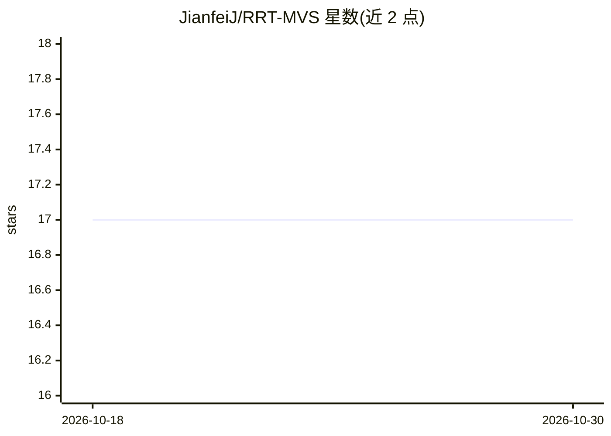

# JianfeiJ/RRT-MVS

⭐ 17 · Python · MIT · 推送 2025-11-04 · [GitHub](https://github.com/JianfeiJ/RRT-MVS) · 组织维护

**AAAI 2025 多视图立体重建 Transformer：预测深度图生成稠密点云**

北京科技大学团队的 AAAI 2025 论文官方代码：提出递归正则化 Transformer（RRT-MVS）做多视图立体（MVS）重建，从多视图图像预测深度图并融合为稠密点云。核心机制包括递归自注意力（R-SA）聚合代价图内与跨图的全局匹配代价、深度残差注意力（DRA）与位置适配器（PA）。提供 DTU/BlendedMVS/Tanks-and-Temples 的训练与测试脚本、预训练模型与重建点云下载，DTU 训练需 RTX 3090（24G），BlendedMVS 微调需 RTX A6000（48G），定量评估部分依赖 MATLAB 脚本。

## 筛选速览

| 维度 | 判定 | 备注 |
|---|---|---|
| AI 角色 | `ai-native` | 本体是模型或模型工具 |
| 许可风险 | `permissive` | MIT |
| 部署形态 | `library` | 以包/库形式分发 |
| 模型依赖 | — | README 未给出锁定关系 |
| 硬件要求 | — | 无带数字的原话,不猜 |
| 安装摩擦 | `medium` | 含编译或系统依赖之一 |
| 成熟度 | — | 结构信号不足 |

## 能力要点

- 递归自注意力 R-SA 在代价图内与跨图聚合全局匹配代价
- 深度残差注意力 DRA 与位置适配器 PA 增强深度相关与 3D 位置感知
- 提供 DTU / BlendedMVS / Tanks-and-Temples 的训练与测试脚本及预训练模型
- 论文报告在 DTU 与 Tanks-and-Temples 数据集上的定量结果（如 DTU Overall 0.285）

## 适用场景

- 复现论文的 MVS 重建实验与定量评估
- 用预训练模型从多视图图像生成稠密点云
- 作为 MVS 方法研究的代码基础进行改进

## 场景标签

 · 领域:计算机视觉/三维重建

## 证据(README 行号)

> L11: Learning-based multi-view stereo methods aim to predict depth maps for reconstructing dense point clouds. These met
> L71: ### Training on DTU (NVIDIA RTX 3090 GPUs, 24G)

## 星数曲线

2026-10-18 17 → 2026-10-30 17（+0）

---
*卡片 v1 · prompt 1.4 · 生成 2026-10-30 · 置信度 high · 依据 README sha `4993a185c39f` · [字段定义](../../DATASET.md)*
