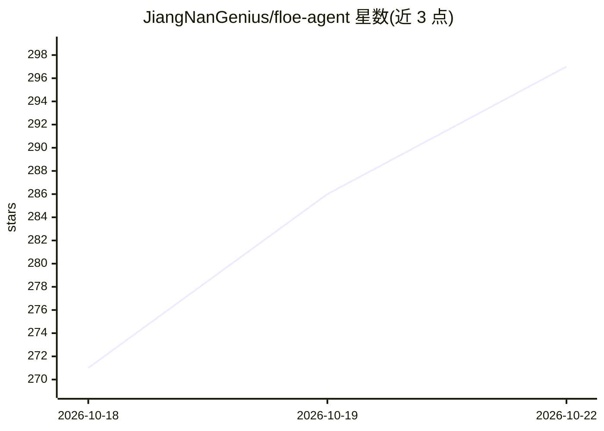

# JiangNanGenius/floe-agent

⭐ 297 · Swift · MPL-2.0 · 推送 2026-10-21 · [GitHub](https://github.com/JiangNanGenius/floe-agent) · [官网](https://www.floe-agent.com/) · 个人维护 · 中文 README

**面向 iPhone/iPad 与 Android 的设备端 AI 智能体工作台**

开源移动端应用：在 iOS/iPadOS 与 Android（alpha）设备上集成 AI 任务、笔记、Office 文档（DOCX/XLSX/PPTX）、Canvas 与创作工具，并提供设备上的持久 Linux 环境运行 shell、Python、Node、apt 包与本地 Web 预览。支持设备端本地模型推理与 BYOK 云端模型（密钥存于设备钥匙串）。iOS 需 26+，通过 TestFlight/Feather/AltStore/自签 IPA 安装；Android 为 ARM64 alpha（9+），当前仅含 BYOK 云聊天，本地环境与本地 AI 尚未在 Android 提供。MPL 2.0。

## 筛选速览

| 维度 | 判定 | 备注 |
|---|---|---|
| AI 角色 | `ai-native` | 本体是模型或模型工具 |
| 许可风险 | `permissive` | MPL-2.0 |
| 部署形态 | `None` |  |
| 模型依赖 | — | README 未给出锁定关系 |
| 硬件要求 | — | 无带数字的原话,不猜 |
| 安装摩擦 | `low` | 无编译、无系统依赖或容器化 |
| 成熟度 | `idea` | |

## 能力要点

- 设备端持久 Linux 环境：shell、Python、Node、apt 包、后台任务与本地 Web 预览
- 支持设备端本地模型推理（系统模型或下载模型，Beta）
- BYOK 云端模型，凭据存于设备钥匙串
- 笔记可导入 PDF/图片、Pencil 批注并就文档提问；Office 三格式创建编辑

## 适用场景

- 在 iPad 上用 AI 任务整合资料、工具操作与产出文件
- 在设备本地跑代码、包管理并预览本地 Web 服务
- 携带自己的 API 密钥使用云端模型聊天

## 场景标签

`AI 助手` `知识库管理` · 领域:对话与助手

## 证据(README 行号)

> L4:  Floe Agent is an open-source on-device AI agent workspace designed for iOS and Android — iPad-first, with native iP
> L49: |On-device AI|Run inference on your device with supported local models — the system model or downloaded models (Bet

## 星数曲线

2026-10-18 271 → 2026-10-22 297（+26）

---
*卡片 v1 · prompt 1.4 · 生成 2026-10-21 · 置信度 high · 依据 README sha `4eb78aca1a61` · [字段定义](../../DATASET.md)*
