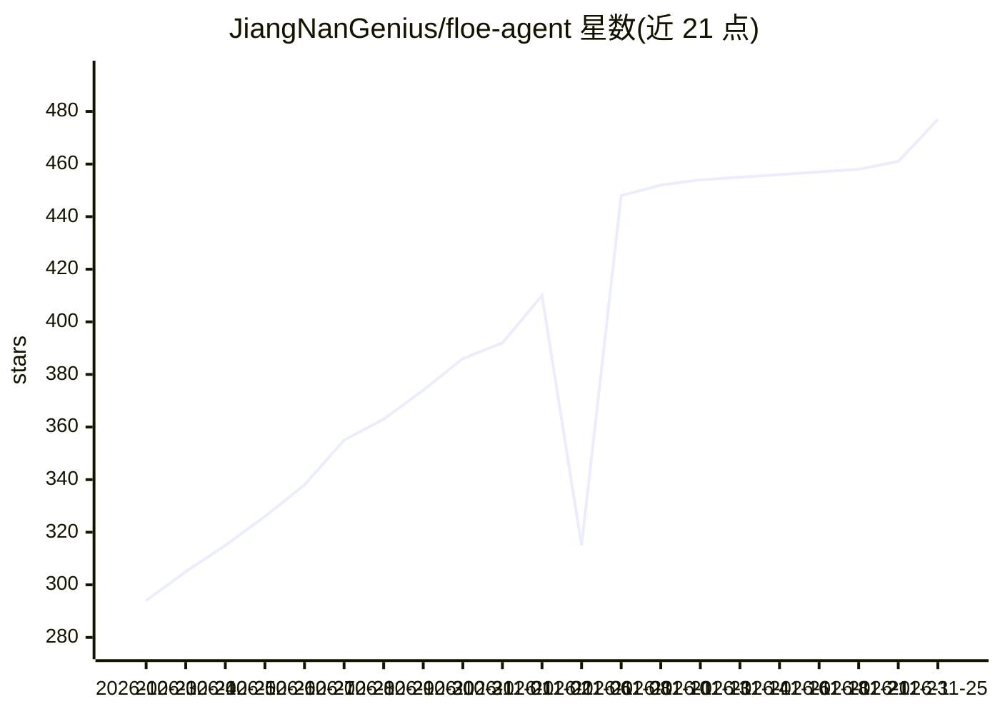

# JiangNanGenius/floe-agent

⭐ 477 · Swift · MPL-2.0 · 推送 2026-11-23 · [GitHub](https://github.com/JiangNanGenius/floe-agent) · [官网](https://www.floe-agent.com/) · 个人维护 · 中文 README

**iOS/iPadOS/Android 设备端开源 AI Agent 工作台，BYOK 接自己的模型**

面向 iOS/iPadOS（主打）与 Android 的开源设备端 AI 工作台：提供任务内持久 Linux 环境，可运行 shell、Python、Node 与本地 web 服务；文档问答、DOCX/XLSX/PPTX 编辑、2D/原生 3D 编辑、画布媒体、语音会议转写与 Skill Hub/MCP 集成。AI 采用 BYOK，用户自配云厂商 API key，iOS/iPadOS 可用 Apple 系统模型或 Beta 本地模型，Android 仅云厂商。基础文档功能可无 AI 使用。分发走 App Store/TestFlight/GitHub IPA/APK/自签渠道。

## 筛选速览

| 维度 | 判定 | 备注 |
|---|---|---|
| AI 角色 | `ai-native` | 本体是模型或模型工具 |
| 许可风险 | `permissive` | MPL-2.0 |
| 部署形态 | `None` |  |
| 模型依赖 | — | README 未给出锁定关系 |
| 硬件要求 | — | 无带数字的原话,不猜 |
| 安装摩擦 | `low` | 无编译、无系统依赖或容器化 |
| 成熟度 | — | 结构信号不足 |

## 能力要点

- 设备端持久 Linux 环境：shell/Python/Node/本地 web 服务与执行历史
- BYOK 自带 API key；iOS/iPadOS 支持 Apple 系统模型与 Beta 本地模型
- 原生 3D/2D 编辑（iOS/iPadOS）与 Pencil 标注、Office 文档编辑
- Skill Hub 管理技能依赖版本，连接 MCP 与自动化服务

## 适用场景

- 在 iPad 上用一个 app 完成文档、代码和 3D 建模任务
- 把终端、Git 与 AI 任务流放进同一工作区
- 用自带 API key 的模型在本地处理会议录音转写与笔记整理

## 场景标签

 · 领域:移动端生产力/AI Agent

## 证据(README 行号)

> L5:  Floe Agent is an open-source AI agent for iOS, iPadOS and Android. Work with documents, code and creative projects 
> L53: **Your first task:** install Floe → configure a model → create a task → open the resulting file. Start with the qui
> L63: For AI, connect your own cloud provider using an API key (**BYOK: bring your own key**). Supported iOS/iPadOS devic

## 星数曲线

2026-10-23 294 → 2026-11-25 477（+183）

---
*卡片 v1 · prompt 1.4 · 生成 2026-11-25 · 置信度 high · 依据 README sha `fcb6450b58b9` · [字段定义](../../DATASET.md)*
