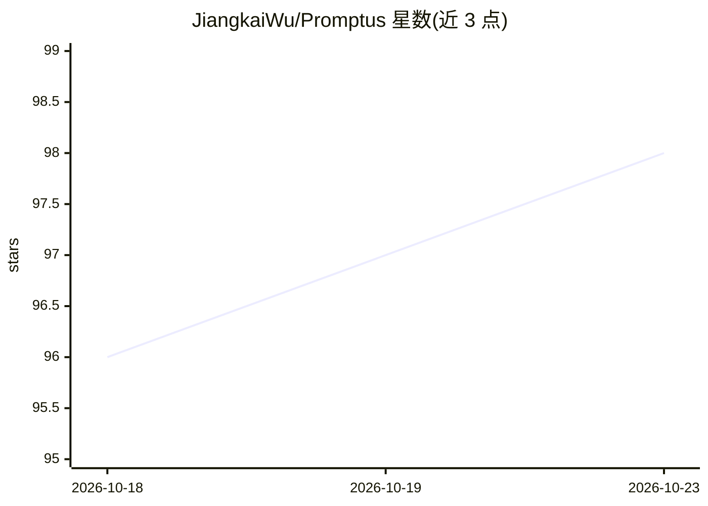

# JiangkaiWu/Promptus

⭐ 98 · Python · Apache-2.0 · 推送 2026-04-20 · [GitHub](https://github.com/JiangkaiWu/Promptus) · [官网](https://arxiv.org/abs/2405.20032) · 组织维护

**AAAI 2026 论文官方实现：用 Stable Diffusion 提示词流替代视频流传输**

论文 Promptus 的官方代码库：发送端将真实视频反演为一系列 'inverse prompts'（多码率等级）进行传输，接收端调用 Stable Diffusion（SD Turbo）生成像素对齐的视频。提供基于 ONNX/TensorRT 引擎的实时生成路径（4090D 上达 170 FPS），并演示了集成到浏览器端视频流平台 Puffer 的方案。安装需 conda 环境与手动下载 SD Turbo 模型，附 sky 与 uvg 两个示例视频及预训练提示词。

## 筛选速览

| 维度 | 判定 | 备注 |
|---|---|---|
| AI 角色 | `ai-native` | 本体是模型或模型工具 |
| 许可风险 | `permissive` | Apache-2.0 |
| 部署形态 | `None` |  |
| 模型依赖 | — | README 未给出锁定关系 |
| 硬件要求 | — | 无带数字的原话,不猜 |
| 安装摩擦 | `low` | 无编译、无系统依赖或容器化 |
| 成熟度 | — | 结构信号不足 |

## 能力要点

- 视频反演为多码率 inverse prompts 并在接收端用 Stable Diffusion 再生成
- ONNX/TensorRT 实时生成引擎，4090D 上达 170 FPS
- 演示与 Puffer 浏览器端视频流平台的集成（媒体服务器替换视频分块为提示词）
- 提供预训练提示词与示例视频，可跳过训练直接体验生成

## 适用场景

- 研究者复现论文的提示词视频流传输方案
- 在自有 GPU 上对自定义视频做反演与实时生成实验
- 探索生成式语义通信/视频压缩的工程实现

## 场景标签

`视频生成` · 领域:内容生成

## 证据(README 行号)

> L5: This is the official implementation of the paper Promptus: Can Prompts Streaming Replace Video Streaming, which repr
> L86: On a single NVIDIA GeForce 4090D, the generation speed reaches 170 FPS. The following video shows an example:

## 星数曲线

2026-10-18 96 → 2026-10-23 98（+2）

---
*卡片 v1 · prompt 1.4 · 生成 2026-10-23 · 置信度 high · 依据 README sha `2f7a653521be` · [字段定义](../../DATASET.md)*
