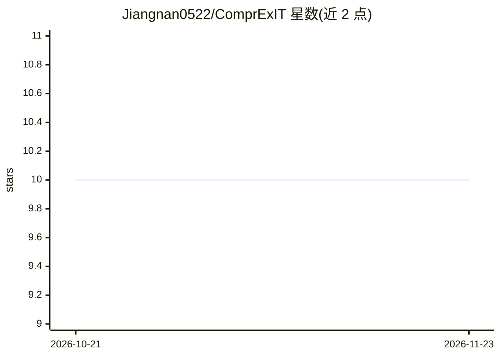

# Jiangnan0522/ComprExIT

⭐ 10 · Python · Apache-2.0 · 推送 2026-11-07 · [GitHub](https://github.com/Jiangnan0522/ComprExIT) · [官网](https://arxiv.org/abs/2602.03784) · 个人维护

**论文官方实现：冻结 LLM 上的软上下文压缩框架**

NeurIPS 2026 论文的官方实现：将长上下文压缩为少量连续压缩 token，方法上把冻结 LLM 用作特征提取器，通过逐层门控聚合 token anchor（深度向）并以 Sinkhorn 最优传输计划分配到压缩槽（宽度向）。代码以 PyTorch/uv 工程形式提供，覆盖两阶段训练（NTP→SFT）与 MRQA 评估全流程，权重与预处理数据集发布在 HuggingFace，并内置 ICAE/500x/SAC 等 baseline 实现；运行依赖 CUDA GPU，SAC 实现标注为实验性且仅在 1B 设置验证。

## 筛选速览

| 维度 | 判定 | 备注 |
|---|---|---|
| AI 角色 | `ai-native` | 本体是模型或模型工具 |
| 许可风险 | `permissive` | Apache-2.0 |
| 部署形态 | `library` | 以包/库形式分发 |
| 模型依赖 | — | README 未给出锁定关系 |
| 硬件要求 | — | 无带数字的原话,不猜 |
| 安装摩擦 | `medium` | 含编译或系统依赖之一 |
| 成熟度 | — | 结构信号不足 |

## 能力要点

- 冻结 LLM、仅新增约 1% 可训练参数的软压缩方法
- 深度向逐层聚合 token anchor + Sinkhorn 最优传输宽度分配
- 内置 ICAE、500x、SAC、Activation Beacon baseline，同一管线复现
- 权重与预处理 MRQA 数据集发布于 HuggingFace collection

## 适用场景

- 复现论文中 ×4 压缩下的 MRQA 评估结果
- 在自己的基座模型上跑 NTP→SFT 两阶段训练
- 在同一套代码里对比多种上下文压缩方法

## 场景标签

`科研工具` · 领域:学习与行业

## 证据(README 行号)

> L34: **ComprExIT** (Context **Compr**ession via **Ex**plicit **I**nformation **T**ransmission) is a
> L50: ComprExIT removes both by treating the **frozen LLM as a feature extractor** and performing
> L171: The code runs on CUDA GPUs (DDP via `nccl`) and uses `liger_kernel`

## 星数曲线

2026-10-21 10 → 2026-11-23 10（+0）

---
*卡片 v1 · prompt 1.4 · 生成 2026-11-20 · 置信度 high · 依据 README sha `d3acaff6763a` · [字段定义](../../DATASET.md)*
