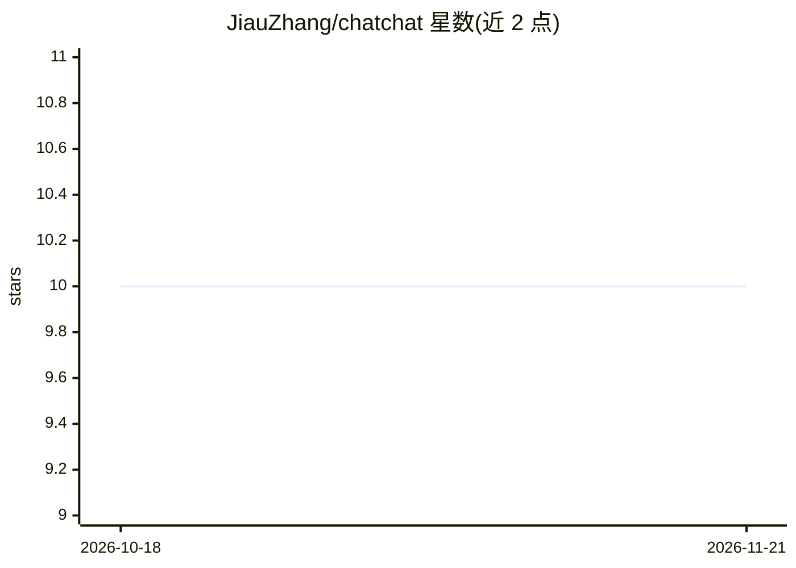

# JiauZhang/chatchat

⭐ 10 · Python · GPL-2.0 · 推送 2026-11-08 · [GitHub](https://github.com/JiauZhang/chatchat) · 个人维护 · 中文 README

**Python 多智能体运行时：带工具/hooks/子代理的 Team 与 LLM 客户端**

Python 编写的 agent 运行时，提供由多个 agent 组成的 Team（含工具、hooks、技能与子代理），底层附带 LLM 客户端，支持 OpenAI Responses 与 Anthropic 两种 API 协议。无内置 provider 列表，通过 ~/.chatchat/config.json 或环境变量/CLI 配置 provider 档案（base_url、api_key、rpm），任何兼容这两种协议的第三方端点只需写一条档案即可接入。通过 pip 安装，要求 Python 3.11+，附 CLI 终端聊天、Team 协作与可运行示例。

## 筛选速览

| 维度 | 判定 | 备注 |
|---|---|---|
| AI 角色 | `ai-ecosystem` | LLM/agent 周边工具 |
| 许可风险 | `viral` | GPL-2.0 |
| 部署形态 | `library` | 以包/库形式分发 |
| 模型依赖 | — | README 未给出锁定关系 |
| 硬件要求 | — | 无带数字的原话,不猜 |
| 安装摩擦 | `low` | 无编译、无系统依赖或容器化 |
| 成熟度 | — | 结构信号不足 |

## 能力要点

- Team 多智能体结构：lead 经 mailbox 分派任务给 teammate 并汇总最终回答
- 同时支持 OpenAI Responses 与 Anthropic 两种 API 协议，第三方端点免代码接入
- hooks 系统支持用户级/项目级 settings.json 三层配置
- 配置文件以 0600 权限写入并对可读性问题告警

## 适用场景

- 在终端用一条 provider/model 字符串直接与 LLM 对话并控制推理档位
- 搭建 lead + teammate 的多智能体协作流程
- 接入自建或第三方 OpenAI/Anthropic 兼容端点统一管理凭证与限流

## 场景标签

`Agent 框架` `多智能体` · 领域:Agent 开发

## 证据(README 行号)

> L3: A Python agent runtime: a `Team` of agents with tools, hooks, skills and
> L4: sub-agents — and the LLM client underneath it, speaking two API protocols.
> L107: A third-party endpoint needs no code — only a profile entry. Anything that
> L108: speaks the Responses or the Anthropic protocol works.

## 星数曲线

2026-10-18 10 → 2026-11-21 10（+0）

---
*卡片 v1 · prompt 1.4 · 生成 2026-11-20 · 置信度 high · 依据 README sha `946e47b11fb8` · [字段定义](../../DATASET.md)*
