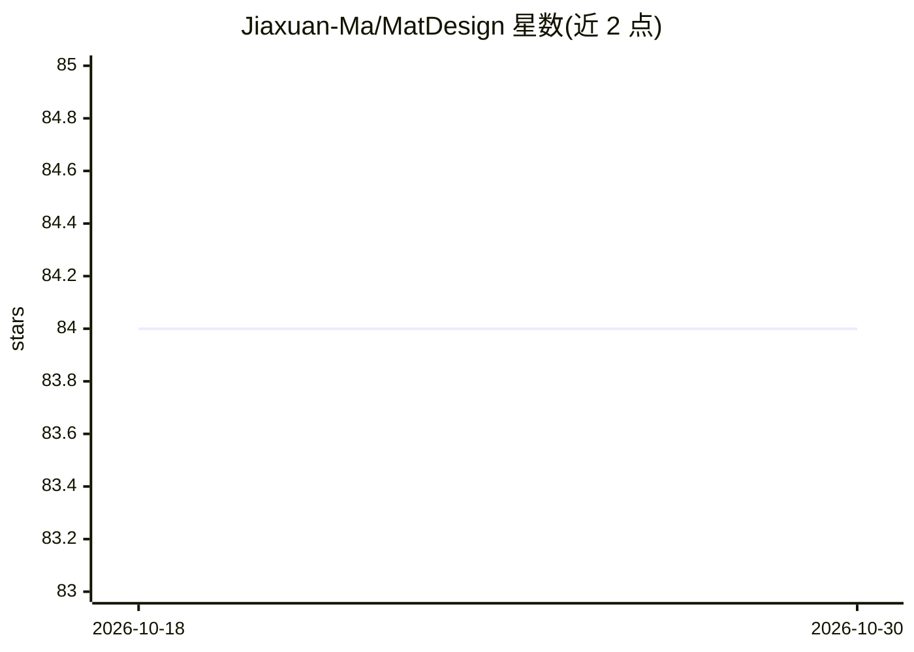

# Jiaxuan-Ma/MatDesign

⭐ 84 · Python · MIT · 推送 2025-12-24 · [GitHub](https://github.com/Jiaxuan-Ma/MatDesign) · 组织维护 · 中文 README

**免编程的 Web 端 AI 材料预测与设计平台**

面向缺乏编程基础的材料领域科研人员的 Web 平台（MLMD），集成材料信息学常用机器学习算法：异常值筛选、特征描述符重构、特征相关性分析与重要性排序等特征工程，支持回归、分类与聚类预测；提供随机优化算法做单目标/多目标材料设计，并用贝叶斯主动学习与迁移学习应对小数据场景。提供远程访问站点 www.matdesign.group，并建议在本地部署以缓解计算资源限制。

## 筛选速览

| 维度 | 判定 | 备注 |
|---|---|---|
| AI 角色 | `ai-native` | 本体是模型或模型工具 |
| 许可风险 | `permissive` | MIT |
| 部署形态 | `None` |  |
| 模型依赖 | — | README 未给出锁定关系 |
| 硬件要求 | — | 无带数字的原话,不猜 |
| 安装摩擦 | `low` | 无编译、无系统依赖或容器化 |
| 成熟度 | — | 结构信号不足 |

## 能力要点

- 回归/分类/聚类预测与特征工程（描述符重构、相关性分析、重要性排序）
- 随机优化算法支持单目标/多目标材料设计
- 贝叶斯主动学习与迁移学习模块应对小数据
- Web 界面免编程使用

## 适用场景

- 我需要预测材料特性但不擅长编程
- 在数据稀缺的情况下通过主动学习设计新材料
- 做多目标性能的材料成分优化

## 场景标签

`科研工具` · 领域:学习与行业

## 证据(README 行号)

> L3: MatDesign is capable of effectively discovering novel materials with high-potential advanced properties end-to-end, 
> L7: 材料基因工程的研发理念深刻变革了材料研发范式，提高了新材料的研发效率，降低了研发成本。材料基因工程研发理念的核心是材料信息学，人工智能技术是材料信息学的核心工具。但是材料领域试验科研人员往往缺乏编程基础，这一门槛限制了利用材料基因理

## 星数曲线

2026-10-18 84 → 2026-10-30 84（+0）

---
*卡片 v1 · prompt 1.4 · 生成 2026-10-24 · 置信度 high · 依据 README sha `ba2fa431dda9` · [字段定义](../../DATASET.md)*
