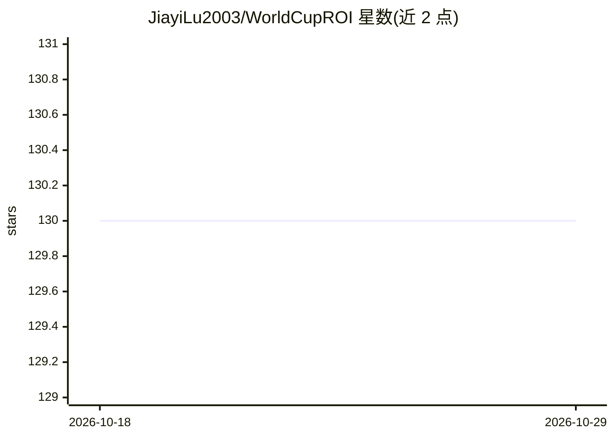

# JiayiLu2003/WorldCupROI

⭐ 130 · Python · 推送 2026-10-09 · [GitHub](https://github.com/JiayiLu2003/WorldCupROI) · [官网](https://github.com/2417467487-hub/WorldCupROI) · 个人维护

**世界杯赞助 ROI 决策平台：比赛数据+文本信号预测与风险分析**

面向体育商业分析师与 ML 评审者的 Streamlit 分析项目：整合真实历史比赛记录、GDELT/Wikimedia 式文本信号与代理/演示商业数据，训练比赛结果与赞助 ROI 基线模型（Centroid 分类器、Ridge 回归），提供 SHAP 式特征贡献、conformal 预测区间、蒙特卡洛风险、场景模拟、预算约束组合优化、因果证据、反事实尾部风险与图学习链路预测，并通过 Discover→Explain→Predict→Simulate→Recommend 仪表盘输出赞助策略建议。README 明确声明赞助支出、转化与 ROI 目标为构造的代理/演示变量，ROI 指标衡量对代理目标的拟合而非真实商业回报。

## 筛选速览

| 维度 | 判定 | 备注 |
|---|---|---|
| AI 角色 | `ai-native` | 本体是模型或模型工具 |
| 许可风险 | `none` | — |
| 部署形态 | `self-host` | docker 或自建部署 |
| 模型依赖 | — | README 未给出锁定关系 |
| 硬件要求 | — | 无带数字的原话,不猜 |
| 安装摩擦 | `low` | 无编译、无系统依赖或容器化 |
| 成熟度 | — | 结构信号不足 |

## 能力要点

- 比赛结果与赞助 ROI 基线模型 + K-fold/子样本/时间滑窗验证
- conformal 区间、蒙特卡洛风险、场景 lift 与预算约束组合优化
- SHAP 式特征贡献与相关/因果证据分离
- 赞助商-球队-球员加权商业图 + 链路预测

## 适用场景

- 对比不同赞助策略的 ROI、风险与场景提升
- 检查模型卡、验证输出与数据边界后复现分析
- 研究比赛表现、媒体文本信号与赞助 ROI 的关联

## 场景标签

`数据分析` · 领域:效率与自动化

## 证据(README 行号)

> L58: |ML modeling|Trains match outcome and sponsor ROI models with validation outputs|Converts sports and attention sign
> L79: |Sponsor ROI proxy|Ridge regression|MAE|0.1165|

## 星数曲线

2026-10-18 130 → 2026-10-29 130（+0）

---
*卡片 v1 · prompt 1.4 · 生成 2026-10-22 · 置信度 high · 依据 README sha `9bfe5b085ca8` · [字段定义](../../DATASET.md)*
