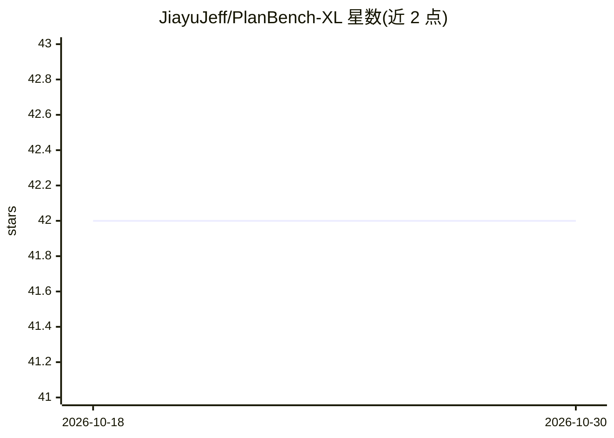

# JiayuJeff/PlanBench-XL

⭐ 42 · Python · 推送 2026-09-19 · [GitHub](https://github.com/JiayuJeff/PlanBench-XL) · [官网](https://planbench-xl.github.io/) · 组织维护

**评测 LLM 工具调用 agent 长程规划能力的基准（1,665 工具）**

EMNLP 2026 论文官方仓库，提供零售领域基准：327 条查询、56 种数据类型、1,665 个工具，测试 agent 在无法一次看到全部工具时的检索-调用-作答循环。机制包括噪声工具（noisy siblings）注入、保留有效解路径的 blocker 事件（显式/隐式/语义误导故障），评测报告覆盖准确率、轮次、无效调用率、噪声工具使用率等指标。通过 OpenAI 兼容 API 接入云端或本地模型，支持单次运行、批量运行与断点续跑；当前代码版本仅覆盖零售领域。

## 筛选速览

| 维度 | 判定 | 备注 |
|---|---|---|
| AI 角色 | `ai-ecosystem` | LLM/agent 周边工具 |
| 许可风险 | `none` | — |
| 部署形态 | `library` | 以包/库形式分发 |
| 模型依赖 | — | README 未给出锁定关系 |
| 硬件要求 | — | 无带数字的原话,不猜 |
| 安装摩擦 | `low` | 无编译、无系统依赖或容器化 |
| 成熟度 | — | 结构信号不足 |

## 能力要点

- 327 查询 / 56 数据类型 / 1,665 工具的零售领域基准
- 噪声工具注入与保留有效解路径的 blocker 事件模拟
- 评测报告含准确率、轮次、无效调用率、噪声工具使用率等
- 支持 OpenAI 兼容端点的 API 与本地模型，输出可断点续跑

## 适用场景

- 评测我的 tool-use agent 在大规模工具生态下的长程规划能力
- 测试 agent 在工具检索噪声与故障注入下的鲁棒性
- 用统一指标对比多个模型的工具调用表现

## 场景标签

`模型评测` · 领域:评测与运维

## 证据(README 行号)

> L16: This is the official repository for **PlanBench-XL**, a benchmark for evaluating LLM agents' **long-horizon plannin
> L20: **PlanBench-XL** tests whether tool-use agents can solve retail planning tasks when they cannot see the whole tool 
> L30: - **Detailed Evaluation**: The evaluator reports answer accuracy, turn counts, search/call balance, invalid tool-ca

## 星数曲线

2026-10-18 42 → 2026-10-30 42（+0）

---
*卡片 v1 · prompt 1.4 · 生成 2026-10-25 · 置信度 mid · 依据 README sha `bdd2f31660be` · [字段定义](../../DATASET.md)*
