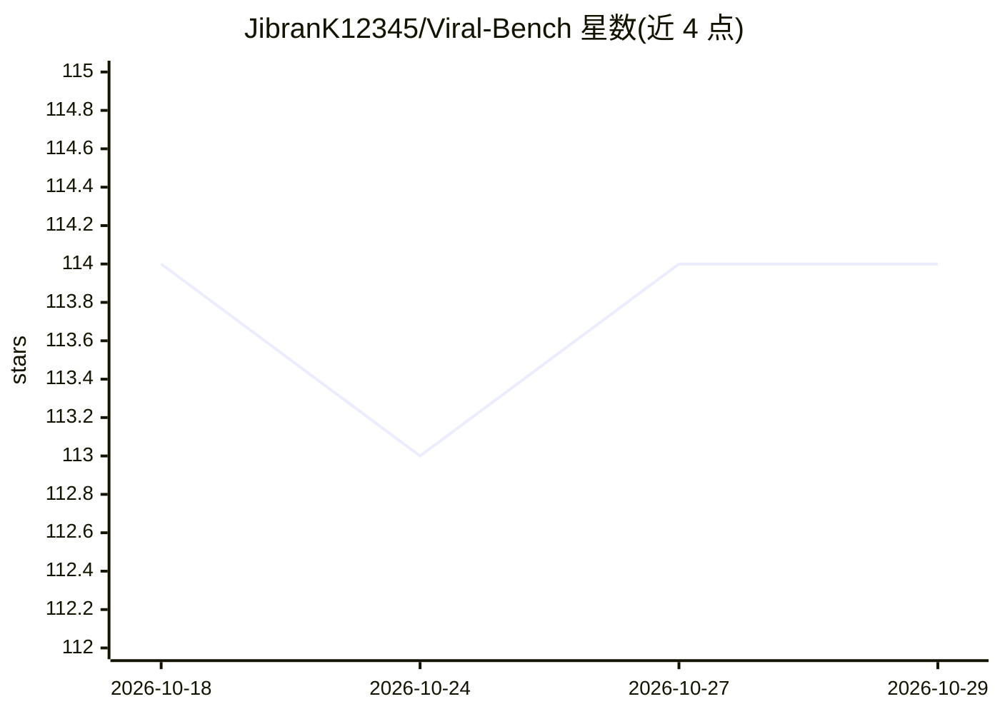

# JibranK12345/Viral-Bench

⭐ 114 · TypeScript · 推送 2026-06-23 · [GitHub](https://github.com/JibranK12345/Viral-Bench) · [官网](https://viralbench.ai) · 个人维护

**自动在 TikTok 获取播放量的 AI 营销 Agent**

自主营销 Agent：读取用户设定的营销目标（GOAL），通过 Lightreel 与 Doublespeed API 生成并投放 TikTok 内容，全程无人工干预；主 Agent 由 OpenRouter 调用 Claude 模型驱动，并借助 SCRAPE_CREATORS 将 TikTok/IG URL 解析为图片供模型查看。以 Node 18+ / TypeScript 脚本形式提供，需配置 Doublespeed 产品与账户 ID；默认 AUTO_QUEUE=false 仅生成草稿不发布，token 有效期约 90 天。

## 筛选速览

| 维度 | 判定 | 备注 |
|---|---|---|
| AI 角色 | `ai-native` | 本体是模型或模型工具 |
| 许可风险 | `none` | — |
| 部署形态 | `library` | 以包/库形式分发 |
| 模型依赖 | locked-api |  |
| 硬件要求 | — | 无带数字的原话,不猜 |
| 安装摩擦 | `low` | 无编译、无系统依赖或容器化 |
| 成熟度 | — | 结构信号不足 |

## 能力要点

- 根据 GOAL 自主生成并投放 TikTok 内容
- 主 Agent 经 OpenRouter 运行 Claude 模型
- SCRAPE_CREATORS 将 TikTok/IG URL 解析为图片供模型查看
- 默认 AUTO_QUEUE=false 留草稿待审核，不自动发布

## 适用场景

- 设定营销目标后让 Agent 自动制作 TikTok 内容
- 生成待人工审核的 TikTok 发布草稿
- 通过 Doublespeed 链接查看投放表现

## 场景标签

`图像生成` · 领域:内容生成

## 证据(README 行号)

> L7: **This agent autonomously gets views on TikTok without any human intervention.**
> L9: To run, get your API key from Lightreel and Doublespeed. Update `GOAL` with your marketing goal.

## 星数曲线

2026-10-18 114 → 2026-10-29 114（+0）

---
*卡片 v1 · prompt 1.4 · 生成 2026-10-23 · 置信度 high · 依据 README sha `a3d25da12529` · [字段定义](../../DATASET.md)*
