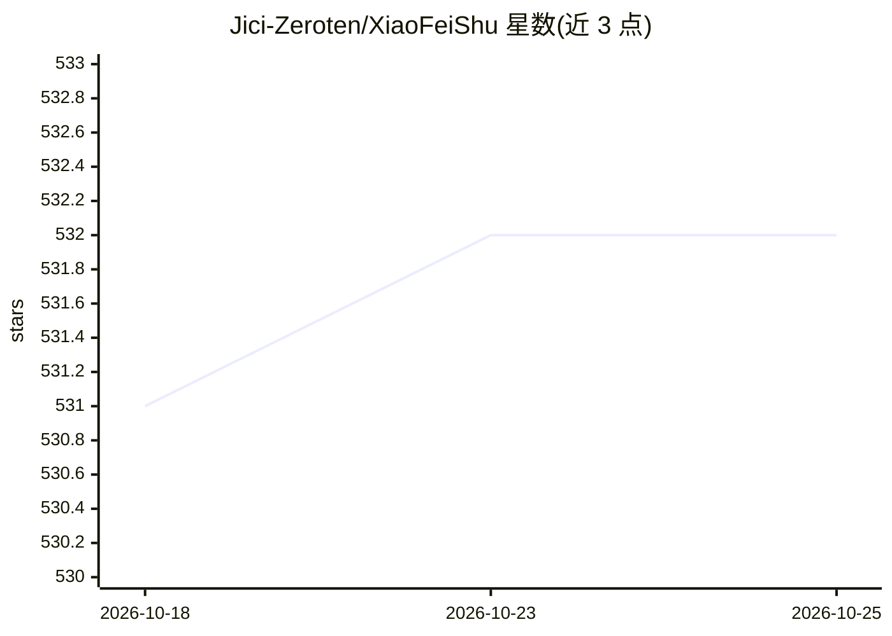

# Jici-Zeroten/XiaoFeiShu

⭐ 532 · 推送 2026-08-01 · [GitHub](https://github.com/Jici-Zeroten/XiaoFeiShu) · [官网](https://jici-zeroten.github.io/XiaoFeiShu/) · 组织维护 · 中文 README

**面向小红书运营者的账号自动化运营软件（已结项）**

小飞薯RPA 是一款面向小红书运营人员与工作室的 Windows 桌面自动化软件，提供账号自动活跃（观看/点赞/收藏/评论）、流量换量、定时发布笔记、热点分析、优选标签、SEO 挖词、爆文挖掘与舆情监控（含多模态模型分析）等工作流。软件通过扫码登录、一机一码绑定，账号数据本地保存并定时清除；采用捐赠制获取使用权，分单用户/多用户版本。README 声明项目已于 2026 年 7 月 31 日结项，不再受理新的申请。仓库不提供源码安装，软件需通过社群联系获取。

## 筛选速览

| 维度 | 判定 | 备注 |
|---|---|---|
| AI 角色 | `ai-enhanced` | 去掉 AI 部分产品仍成立 |
| 许可风险 | `none` | — |
| 部署形态 | `None` |  |
| 模型依赖 | — | README 未给出锁定关系 |
| 硬件要求 | — | 无带数字的原话,不猜 |
| 安装摩擦 | `low` | 无编译、无系统依赖或容器化 |
| 成熟度 | — | 结构信号不足 |

## 能力要点

- 自动活跃账号、自动精准评论、自动流量换量、定时发布笔记等自动化工作流
- 小红书热点分析、优选标签、SEO 挖词、定向领域爆文挖掘
- 舆情监控支持实时监控、大数据可视化、多模态模型分析与局域网报告共享
- 无感化后台运行，模拟真实用户操作以规避检测

## 适用场景

- 小红书新人养号与多账号日常运营自动化
- 运营团队做流量换量（双向奔赴、抱团取暖）
- 监控社会舆情并生成可视化分析报告
- 挖掘小红书热点、优选标签与爆文选题

## 场景标签

`GUI 自动化` `网页抓取` · 领域:效率与自动化

## 证据(README 行号)

> L11: 📱 小飞薯RPA是一款紧贴小红书优质用户规则开发的自动化软件，💥提供了一套小红书运营自动化工作流解决方案，🎯避免了传统RPA机械化、规则化、易被检测的问题。💡 软件易上手，运行方式简单，功能强大。💪
> L126: ✅ 社会舆情监控（支持实时舆情监控、舆情大数据可视化分析、多模态模型分析、舆情报告局域网共享）

## 星数曲线

2026-10-18 531 → 2026-10-25 532（+1）

---
*卡片 v1 · prompt 1.4 · 生成 2026-10-22 · 置信度 high · 依据 README sha `0661c632afcf` · [字段定义](../../DATASET.md)*
