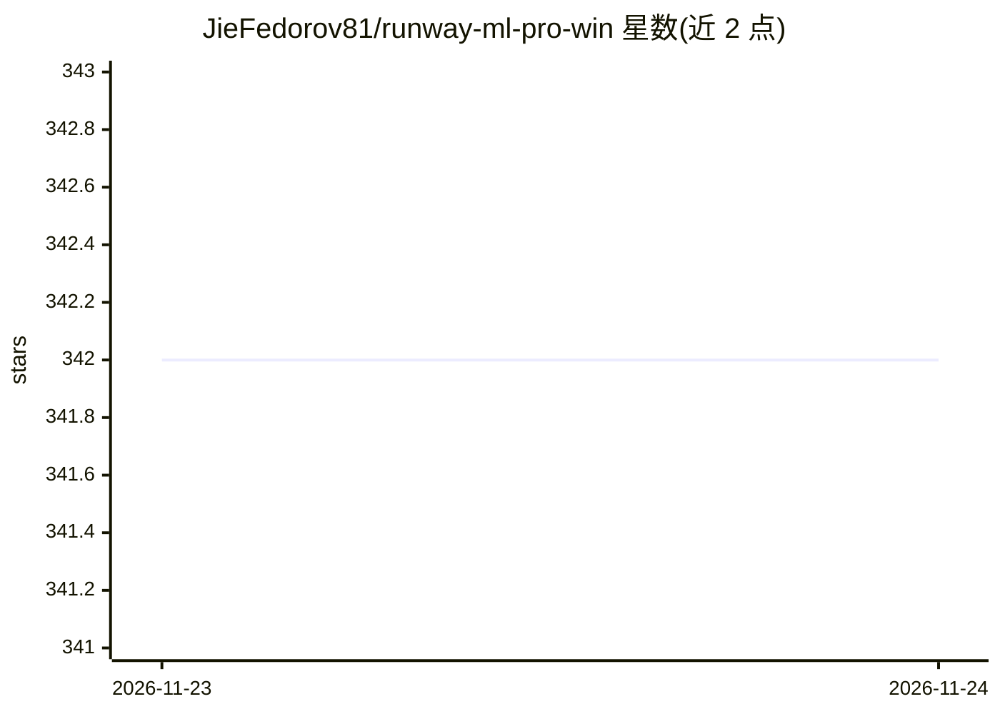

# JieFedorov81/runway-ml-pro-win

⭐ — · [GitHub]() · 个人维护

**面向 Windows 用户的 Runway ML Pro AI 视频平台参考与安装指引**

该仓库内容是一份 Windows 平台上的 Runway ML Pro 参考与设置指南，介绍其文生视频、图像动画、Motion Brush 局部运动控制等功能，以及 Windows 10/11 的系统要求、首次运行流程与导出步骤。生成处理在云端进行，本地机器主要承担界面与预览播放。仓库本身不托管安装包，指引从官方来源下载；许可证信息未在此提供，需查阅软件附带条款。

## 筛选速览

| 维度 | 判定 | 备注 |
|---|---|---|
| AI 角色 | `ai-knowledge` | 知识聚合/清单类 |
| 许可风险 | `none` | — |
| 部署形态 | `None` |  |
| 模型依赖 | — | README 未给出锁定关系 |
| 硬件要求 | — | 无带数字的原话,不猜 |
| 安装摩擦 | `low` | 无编译、无系统依赖或容器化 |
| 成熟度 | — | 结构信号不足 |

## 能力要点

- 覆盖文生视频、图生视频动画与 Motion Brush 区域运动控制的平台介绍
- 给出 Windows 10/11 x64 的系统要求表与运行时依赖（Chromium 浏览器/桌面应用、DirectX 11+）
- 说明云端生成模式，本地硬件主要影响界面与预览而非生成结果
- 提供从输入提示词到生成、精修、导出的工作流程说明

## 适用场景

- 在 Windows 10/11 上按指引安装并配置 Runway ML Pro 桌面应用
- 为概念视频、分镜预览制作生成短片
- 用 Motion Brush 对画面局部元素做定向运动控制

## 场景标签

`视频生成` `图像生成` · 领域:内容生成

## 证据(README 行号)

> L3:  A Windows reference and setup guide for the Runway ML Pro AI video platform, generative capabilities, system profil
> L19: Runway ML Pro is an AI video generation platform that lets you turn written prompts into short video clips, animate

## 星数曲线

2026-11-23 342 → 2026-11-24 342（+0）

---
*卡片 v1 · prompt 1.4 · 生成 2026-11-23 · 置信度 mid · 依据 README sha `13a2cfdf0d92` · [字段定义](../../DATASET.md)*
