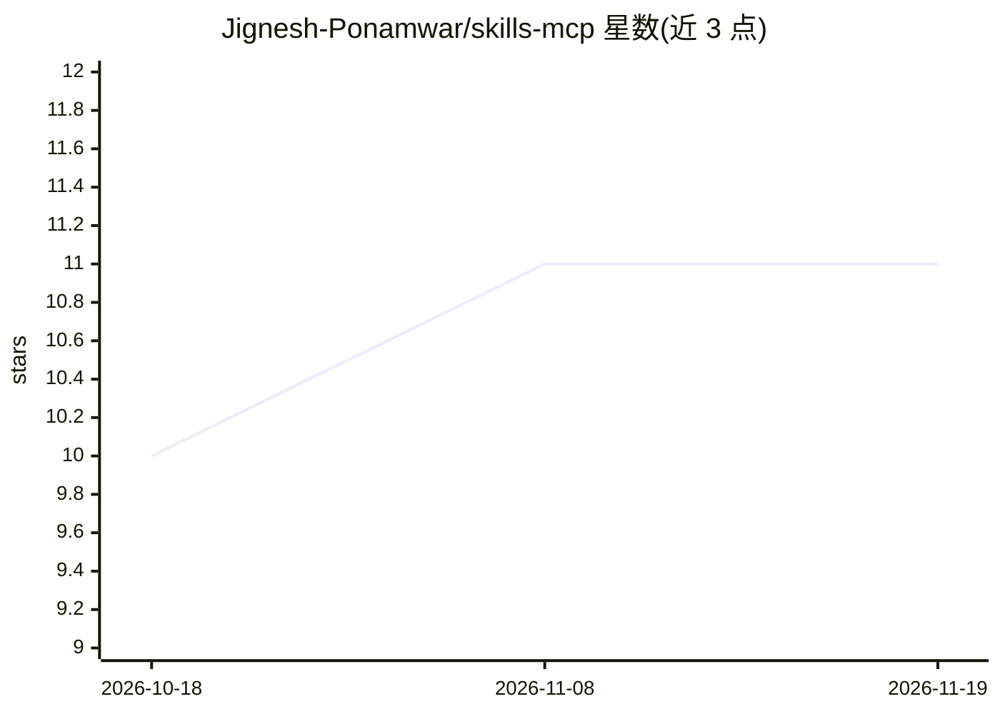

# Jignesh-Ponamwar/skills-mcp

⭐ 11 · Python · Apache-2.0 · 推送 2026-05-29 · [GitHub](https://github.com/Jignesh-Ponamwar/skills-mcp) · [官网](https://skills-mcp-jignesh.vercel.app/) · 个人维护

**给 MCP agent 提供共享可检索技能库的自托管注册中心**

将 SKILL.md 格式的 Agent Skills 集中到一个语义可搜索的注册中心，agent 通过 MCP 协议在运行时按需发现和加载技能，避免每个工具/仓库各自打包技能文件。采用三层渐进式披露：先语义搜索返回评分结果，再加载完整指令与清单，最后仅在需要时读取参考文档或执行脚本。部署在 Cloudflare Workers，嵌入用 Cloudflare Workers AI（bge-small-en-v1.5，384 维），仅嵌入 description + trigger_phrases；向量存储依赖 Qdrant。附带 30+ 个从官方文档整理的技能。

## 筛选速览

| 维度 | 判定 | 备注 |
|---|---|---|
| AI 角色 | `ai-ecosystem` | LLM/agent 周边工具 |
| 许可风险 | `permissive` | Apache-2.0 |
| 部署形态 | `self-host` | docker 或自建部署 |
| 模型依赖 | — | README 未给出锁定关系 |
| 硬件要求 | — | 无带数字的原话,不猜 |
| 安装摩擦 | `low` | 无编译、无系统依赖或容器化 |
| 成熟度 | — | 结构信号不足 |

## 能力要点

- 三层渐进式披露：搜索→加载→按需读取参考/脚本
- 仅嵌入 frontmatter（约 100 tokens）保持向量空间干净
- 自托管于 Cloudflare Workers，无服务器架构
- 内置 30+ 技能，含复杂度、前置知识与来源 URL 元数据

## 适用场景

- 让团队多个 agent 共享同一套组织内部流程与最佳实践
- API 版本变更时集中更新技能，agent 无需重新训练或改提示词
- 统一不同框架下 agent 产出的代码风格与审查标准

## 场景标签

`语义搜索` · 领域:知识与检索

## 证据(README 行号)

> L7: **Agent Skills — delivered over MCP.**
> L8: One shared, searchable skill library that any MCP agent loads at runtime, instead of bundling skill files into every
> L85: Your Skills registry lives on **Cloudflare Workers** — no servers to manage, no uptime monitoring, no database admi

## 星数曲线

2026-10-18 10 → 2026-11-19 11（+1）

---
*卡片 v1 · prompt 1.4 · 生成 2026-11-19 · 置信度 mid · 依据 README sha `9c02de823433` · [字段定义](../../DATASET.md)*
