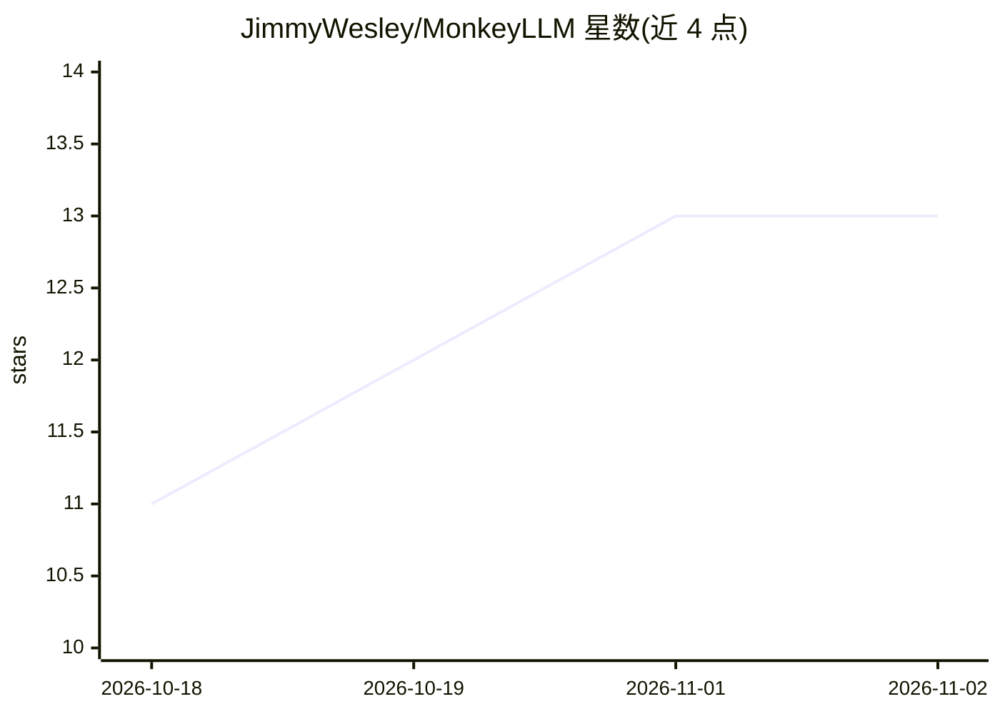

# JimmyWesley/MonkeyLLM

⭐ 13 · Python · Apache-2.0 · 推送 2026-09-18 · [GitHub](https://github.com/JimmyWesley/MonkeyLLM) · [官网](https://monkeyllm.com) · 个人维护

**面向 AI agent 的知识引擎：文档变 MCP 知识图谱供导航**

Python 包（Apache-2.0）加 vine CLI：将文档（md/docx/pdf/表格/数据库等）转换为 git 版本化的 markdown 知识森林，每个节点带摘要护照与类型化边；agent 通过 10 个原语（locate/move/plant 等）导航而非向量检索，表格转 SQLite 供只读 SQL 查询，答案带引用。可通过 stdio/HTTP MCP 接入 Claude Code 等 MCP 运行时。附 Station 服务端（REST/MCP）、Studio 网页控制台、浏览器剪藏扩展与 Docker 部署。基准：12B 本地模型多跳问答 11/11，对照 top-k RAG 0/11。

## 筛选速览

| 维度 | 判定 | 备注 |
|---|---|---|
| AI 角色 | `ai-ecosystem` | LLM/agent 周边工具 |
| 许可风险 | `permissive` | Apache-2.0 |
| 部署形态 | `self-host` | docker 或自建部署 |
| 模型依赖 | — | README 未给出锁定关系 |
| 硬件要求 | — | 无带数字的原话,不猜 |
| 安装摩擦 | `low` | 无编译、无系统依赖或容器化 |
| 成熟度 | — | 结构信号不足 |

## 能力要点

- 文档转 git 版本化 markdown 知识森林，节点带摘要护照与类型化边
- MCP 服务（stdio/HTTP）向任意 MCP agent 暴露 10 个 token 预算化原语
- 表格文件转 SQLite 表供只读 SQL 查询，答案带引用
- 提供 Station 托管层、Studio 控制台、浏览器 Clipper 扩展与 Docker 部署

## 适用场景

- 让我的编码 agent 通过 MCP 拥有可持续读写的知识库
- 把既有文档目录镜像为可导航的知识图谱供 agent 查询
- 团队以 Station 共享治理一个知识森林并按策略授权

## 场景标签

`Agent 记忆` `知识图谱` `知识库管理` · 领域:Agent 开发

## 证据(README 行号)

> L5: **A knowledge engine for AI agents: a new way to query your data.** Your
> L71: And the same forest speaks **MCP** to any agent, straight from the CLI:
> L74: vine serve --forest ./brain                    # stdio MCP server

## 星数曲线

2026-10-18 11 → 2026-11-02 13（+2）

---
*卡片 v1 · prompt 1.4 · 生成 2026-10-31 · 置信度 high · 依据 README sha `5446366a0e13` · [字段定义](../../DATASET.md)*
