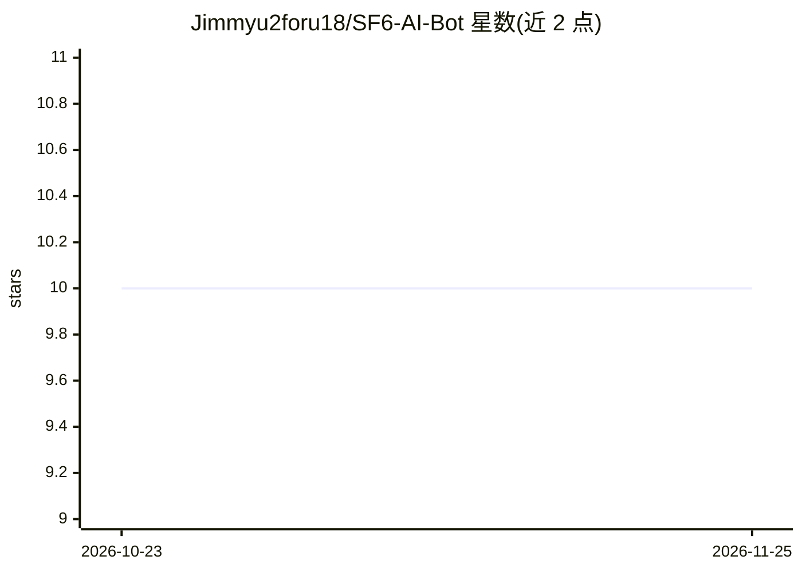

# Jimmyu2foru18/SF6-AI-Bot

⭐ 10 · Python · 推送 2026-08-08 · [GitHub](https://github.com/Jimmyu2foru18/SF6-AI-Bot) · 个人维护

**用强化学习与本地 LLM 自动操作《街霸6》的 AI 机器人**

面向 Windows 的《街头霸王6》双模式 AI 系统：训练模式用 Stable-Baselines3 的 PPO 在自定义 Gymnasium 环境中训练智能体，输入为 DXCam 屏幕捕获的 84x84 RGB 帧与结构化奖励信号；Juri AI 模式通过 Ollama 调用 DeepSeek R1:14B 做上下文感知决策，异步查询避免阻塞战斗循环。输入经 vJoy 虚拟手柄或 Win32 键盘输出，学习数据以 JSON/Markdown 持久化，含自定义房自动化与安装校验脚本。

## 筛选速览

| 维度 | 判定 | 备注 |
|---|---|---|
| AI 角色 | `ai-native` | 本体是模型或模型工具 |
| 许可风险 | `none` | — |
| 部署形态 | `library` | 以包/库形式分发 |
| 模型依赖 | local-ok | 支持本地模型 |
| 硬件要求 | — | 无带数字的原话,不猜 |
| 安装摩擦 | `medium` | 含编译或系统依赖之一 |
| 成熟度 | — | 结构信号不足 |

## 能力要点

- PPO 强化学习训练与 LLM 实时决策双模式
- DXCam 60+ FPS 屏幕捕获，21 个离散动作空间
- DeepSeek R1:14B 异步查询，长期记忆与战术学习数据持久化
- vJoy 虚拟手柄为主、Win32 键盘兜底的输入层

## 适用场景

- 在 SF6 训练模式中训练自动对战模型
- 让 LLM 驱动的 Juri 机器人做实时对局决策
- 自动化自定义房对局并记录学习数据

## 场景标签

`强化学习` `GUI 自动化` · 领域:效率与自动化

## 证据(README 行号)

> L3: A dual-mode AI system for Street Fighter 6 combining reinforcement learning training with LLM-powered real-time deci
> L9: **Training Mode** - Trains a PPO reinforcement learning agent using Stable-Baselines3 with a custom Gymnasium enviro
> L11: **Juri AI Mode** - Uses DeepSeek R1:14B via Ollama for context-aware decision making. Analyzes game state through c

## 星数曲线

2026-10-23 10 → 2026-11-25 10（+0）

---
*卡片 v1 · prompt 1.4 · 生成 2026-11-20 · 置信度 high · 依据 README sha `47e70e5b5888` · [字段定义](../../DATASET.md)*
