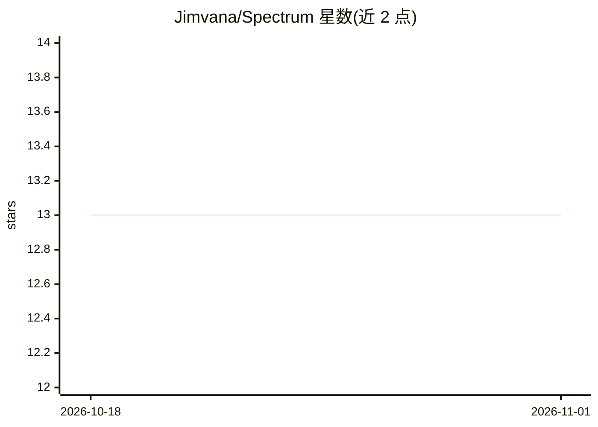

# Jimvana/Spectrum

⭐ 13 · Python · NOASSERTION · 推送 2026-05-20 · [GitHub](https://github.com/Jimvana/Spectrum) · [官网](https://bytespectrum.cc/) · 个人维护

**把代码库打包为无损可检索 .specpack 的本地 CLI 存储/检索层**

Spectrum 以 npm 安装的 CLI（spectrumstore@0.1.0-preview.5）提供：将代码或文本目录编码为紧凑、无损、可检索的 .specpack 数据，把语义 token 映射为稳定整数 ID 并施加行程与倒排压缩，检索直接在编码表示上进行，支持按需解码回原始字节并提供 verify 校验。可本地启动 HTTP API 供 agent、RAG 工具与检索工作流查询。要求 Node.js 18+ 与 Python 3.10+。附基准 HUD，与 FAISS/BM25/TF-IDF/Chroma/混合检索对比。面向需要本地精确代码库检索与源上下文重建的开发者。

## 筛选速览

| 维度 | 判定 | 备注 |
|---|---|---|
| AI 角色 | `ai-ecosystem` | LLM/agent 周边工具 |
| 许可风险 | `none` | NOASSERTION |
| 部署形态 | `library` | 以包/库形式分发 |
| 模型依赖 | — | README 未给出锁定关系 |
| 硬件要求 | — | 无带数字的原话,不猜 |
| 安装摩擦 | `low` | 无编译、无系统依赖或容器化 |
| 成熟度 | `idea` | |

## 能力要点

- 存储与检索合一的确定性 .specpack 编码，可逐字节还原源文件
- 本地 HTTP API（默认 127.0.0.1:7777）供 agent/RAG 检索与 hydrate
- 支持 append、verify、search、unpack、项目工作流与带 GUI 的 Spectrum Hub
- 内置 CodeRAG 基准 HUD，对比 FAISS Flat、BM25、TF-IDF、Chroma 等基线

## 适用场景

- 把代码库打包成本地可检索存储，供 AI agent 与 RAG 工具查询精确源码
- 在不保留原始分块和独立索引的前提下做代码检索与上下文重建
- 对大型代码语料做紧凑、无损、可解释的归档与检索

## 场景标签

`RAG` `语义搜索` · 领域:知识与检索

## 证据(README 行号)

> L19: install, packs your repo into a compact `.specpack`, then starts the local HTTP
> L41: Use it when you want local, exact, searchable codebase packs for agents, RAG
> L64: - AI agent memory

## 星数曲线

2026-10-18 13 → 2026-11-01 13（+0）

---
*卡片 v1 · prompt 1.4 · 生成 2026-10-31 · 置信度 high · 依据 README sha `58ede43a9dba` · [字段定义](../../DATASET.md)*
