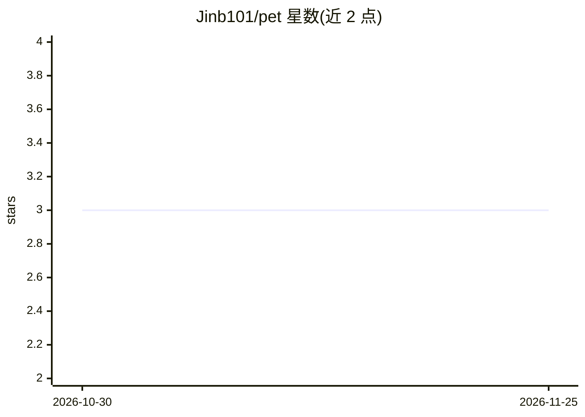

# Jinb101/pet

⭐ 3 · HTML · 推送 2026-10-27 · [GitHub](https://github.com/Jinb101/pet) · 个人维护 · 中文 README

**互动直播玩法工具：复刻抖音 AI 虚拟主播打工互动**

一个以网页形式运行的互动直播玩法工具，复刻抖音「AI 虚拟主播打工」互动直播模式，提供 token 工资系统、专注回合机制、摸鱼/被抓/白干等状态玩法，并支持观众弹幕互动与礼物投喂。README 给出通过 PowerShell 脚本启动本地服务的方式，运行后访问本地地址进入页面。可见文档较简短，未说明模型接入与具体技术实现细节。

## 筛选速览

| 维度 | 判定 | 备注 |
|---|---|---|
| AI 角色 | `ai-native` | 本体是模型或模型工具 |
| 许可风险 | `none` | — |
| 部署形态 | `None` |  |
| 模型依赖 | — | README 未给出锁定关系 |
| 硬件要求 | — | 无带数字的原话,不猜 |
| 安装摩擦 | `low` | 无编译、无系统依赖或容器化 |
| 成熟度 | — | 结构信号不足 |

## 能力要点

- token 工资系统与专注回合玩法
- 摸鱼·被抓·白干等状态机制
- 弹幕互动与礼物投喂支持
- PowerShell 脚本一键启动本地服务

## 适用场景

- 在直播中运行 AI 虚拟主播打工互动玩法
- 让观众通过弹幕和礼物参与直播间互动

## 场景标签

 · 领域:直播/互动娱乐工具

## 证据(README 行号)

> L3: AI 打工直播玩法工具（复刻抖音「AI 虚拟主播打工」互动直播）
> L5: - token 工资系统 / 专注回合 / 摸鱼·被抓·白干 / 弹幕互动 / 礼物投喂

## 星数曲线

2026-10-30 3 → 2026-11-25 3（+0）

---
*卡片 v1 · prompt 1.4 · 生成 2026-11-22 · 置信度 low · 依据 README sha `225abdf6123e` · [字段定义](../../DATASET.md)*
