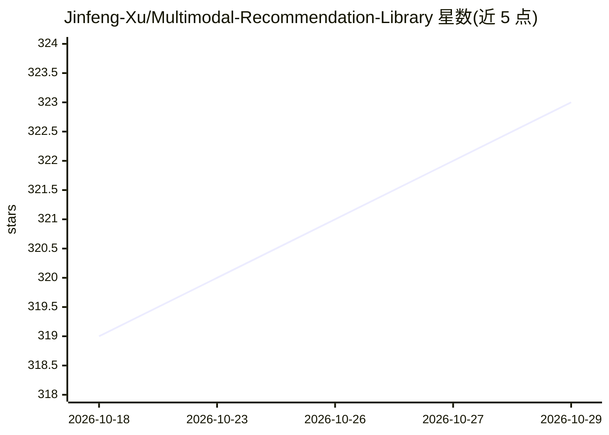

# Jinfeng-Xu/Multimodal-Recommendation-Library

⭐ 323 · Python · MIT · 推送 2026-10-27 · [GitHub](https://github.com/Jinfeng-Xu/Multimodal-Recommendation-Library) · 组织维护 · 中文 README

**面向研究的多模态推荐模型库与基准（26 个模型）**

MRLib 是研究导向的多模态推荐开源库：收录 2016-2026 年来自 AAAI、ACM MM、SIGIR、WWW 等会议/期刊的 26 个模型实现，提供统一运行入口（python src/main.py）、YAML 配置、自动模态文件发现（.npy/.pt 特征）、按模型划分的图缓存与训练实时可视化。支持 Amazon 系列与 TikTok、Microlens 数据集，附 Baby 数据集上各模型的 Recall/NDCG 基准表；自定义模型可继承 GeneralRecommender 接入。代码结构基于 MMRec，安装方式为 git clone 源码。

## 筛选速览

| 维度 | 判定 | 备注 |
|---|---|---|
| AI 角色 | `ai-ecosystem` | LLM/agent 周边工具 |
| 许可风险 | `permissive` | MIT |
| 部署形态 | `None` |  |
| 模型依赖 | — | README 未给出锁定关系 |
| 硬件要求 | — | 无带数字的原话,不猜 |
| 安装摩擦 | `low` | 无编译、无系统依赖或容器化 |
| 成熟度 | — | 结构信号不足 |

## 能力要点

- 收录 26 个多模态推荐模型实现，按发表年份持续更新
- 自动扫描 *_feat.npy/.pt 文件发现模态，按数据集动态加载
- Baby 数据集上的 Recall@N/NDCG@N 基准与训练耗时记录
- 自定义模型通过继承 GeneralRecommender 接入

## 适用场景

- 在同一框架下对比多个多模态推荐模型的表现
- 复现顶会多模态推荐论文的实验结果
- 基于现有代码结构开发自己的推荐模型

## 场景标签

`推荐系统` · 领域:学习与行业

## 证据(README 行号)

> L3:  **MRLib** is an open-source, research-oriented library for multimodal recommendation.
> L10: - [2026.04]🎯[Update]: We release the MRLib as a comprehensive benchmark and code base for mutlimodal recommendation

## 星数曲线

2026-10-18 319 → 2026-10-29 323（+4）

---
*卡片 v1 · prompt 1.4 · 生成 2026-10-21 · 置信度 high · 依据 README sha `8d28bb07ae43` · [字段定义](../../DATASET.md)*
