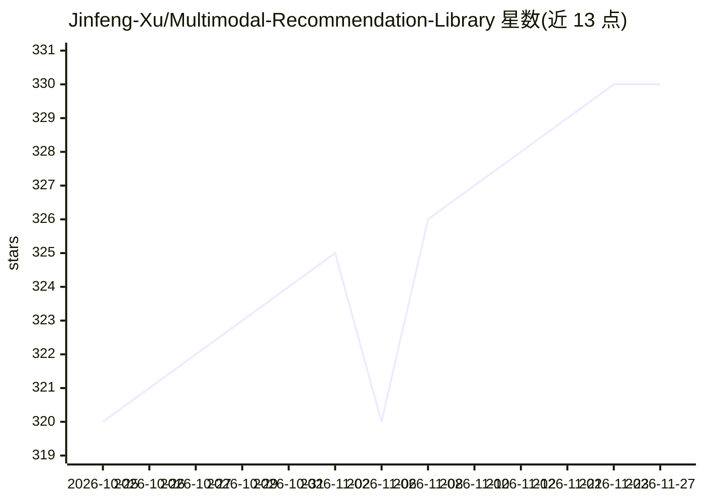

# Jinfeng-Xu/Multimodal-Recommendation-Library

⭐ 330 · Python · MIT · 推送 2026-10-29 · [GitHub](https://github.com/Jinfeng-Xu/Multimodal-Recommendation-Library) · 个人维护 · 中文 README

**面向研究者的多模态推荐模型基准库（收录 26 个模型）**

开源研究型多模态推荐代码库，收录 26 个模型（VBPR 至 2026 年多个顶会工作）并提供统一入口：自动扫描 *_feat.npy/*_feat.pt 发现模态特征、按模型分目录缓存图结构、训练指标实时可视化。支持 Amazon Baby/Sports/Clothing 等与 TikTok/Microlens 数据集及自定义格式，YAML 配置模型与数据集，附 Baby 数据集基准结果日志与自定义模型接入流程，MIT 许可。

## 筛选速览

| 维度 | 判定 | 备注 |
|---|---|---|
| AI 角色 | `ai-native` | 本体是模型或模型工具 |
| 许可风险 | `permissive` | MIT |
| 部署形态 | `None` |  |
| 模型依赖 | — | README 未给出锁定关系 |
| 硬件要求 | — | 无带数字的原话,不猜 |
| 安装摩擦 | `low` | 无编译、无系统依赖或容器化 |
| 成熟度 | — | 结构信号不足 |

## 能力要点

- 收录 26 个多模态推荐模型并持续从顶会论文集成
- 自动扫描 *_feat.npy/*_feat.pt 文件发现模态，支持视觉/文本/音频等
- 按模型的图缓存目录与参数校验
- 提供 Baby 数据集 26 个模型的基准指标结果表

## 适用场景

- 在自己的数据集上复现或对比多个多模态推荐模型
- 按论文格式继承 GeneralRecommender 接入自定义模型
- 查看 Baby 数据集上各模型的 Recall/NDCG 等基准结果

## 场景标签

`推荐系统` `多模态` · 领域:学习与行业

## 证据(README 行号)

> L3:  **MRLib** is an open-source, research-oriented library for multimodal recommendation.
> L88: python src/main.py -m HPMRec -d baby

## 星数曲线

2026-10-25 320 → 2026-11-27 330（+10）

---
*卡片 v1 · prompt 1.4 · 生成 2026-11-25 · 置信度 high · 依据 README sha `38811ab9481e` · [字段定义](../../DATASET.md)*
