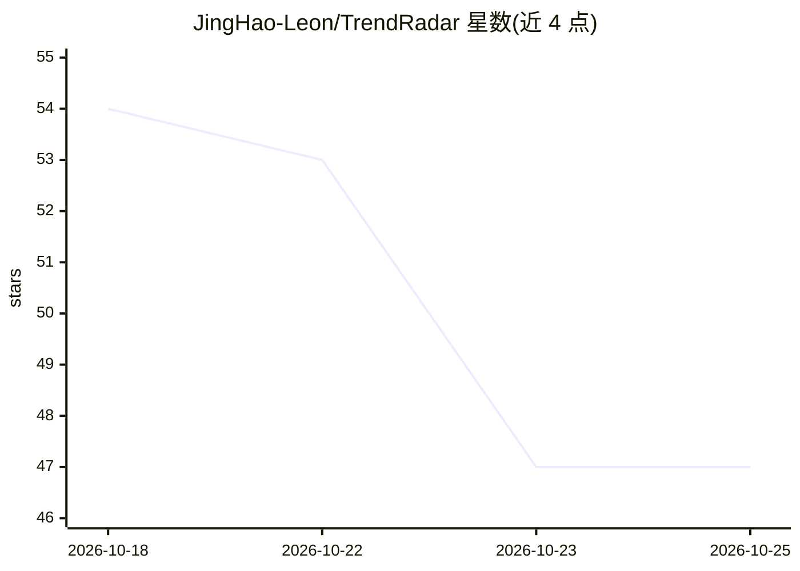

# JingHao-Leon/TrendRadar

⭐ 47 · Python · MIT · 推送 2026-08-05 · [GitHub](https://github.com/JingHao-Leon/TrendRadar) · 个人维护 · 中文 README

**聚合微博/知乎/B站热点并做情感趋势分析的CLI工具**

Python 命令行工具，一条流水线完成并发抓取三个平台公开榜单、jieba+Jaccard 跨平台事件聚合、情感打分与趋势分计算，最终生成单文件 HTML 报告（matplotlib 渲染内嵌、零 JS 依赖）。面向自媒体、内容运营与品牌公关场景。情感后端可插拔：默认 SnowNLP 离线（短文本约 70-75% 准确率），可切换 Ollama + 本地 LLM。提供 mock 数据离线 demo 模式；时序过滤字段为占位未实现。约 1700 行 Python，课程作业规模，MIT 协议，仅供学习研究。

## 筛选速览

| 维度 | 判定 | 备注 |
|---|---|---|
| AI 角色 | `ai-native` | 本体是模型或模型工具 |
| 许可风险 | `permissive` | MIT |
| 部署形态 | `library` | 以包/库形式分发 |
| 模型依赖 | local-ok | 支持本地模型 |
| 硬件要求 | — | 无带数字的原话,不猜 |
| 安装摩擦 | `low` | 无编译、无系统依赖或容器化 |
| 成熟度 | — | 结构信号不足 |

## 能力要点

- 三平台并发抓取，单平台失败不影响整体出报告
- jieba 分词 + Jaccard 相似度（阈值 0.35 可调）跨平台事件聚合
- 情感后端可插拔：SnowNLP 离线 / Ollama 本地 LLM
- matplotlib 服务端渲染生成零 JS 依赖的单文件 HTML 报告

## 适用场景

- 一条命令把微博/知乎/B站热点聚合到一份报告里看
- 给热点事件打情感分与风险标签，跟踪舆情走向
- 无外网或 CI 环境下用 mock 数据生成演示报告

## 场景标签

`数据分析` `网页抓取` · 领域:效率与自动化

## 证据(README 行号)

> L29: ### 🎭 情感 + 趋势双评分
> L36: 默认 SnowNLP（离线、零费用）；一行配置切换 Ollama + 本地 LLM（如 qwen2:7b），准确率更高、依然零 API 费用。

## 星数曲线

2026-10-18 54 → 2026-10-25 47（-7）

---
*卡片 v1 · prompt 1.4 · 生成 2026-10-25 · 置信度 high · 依据 README sha `c03f752894fe` · [字段定义](../../DATASET.md)*
