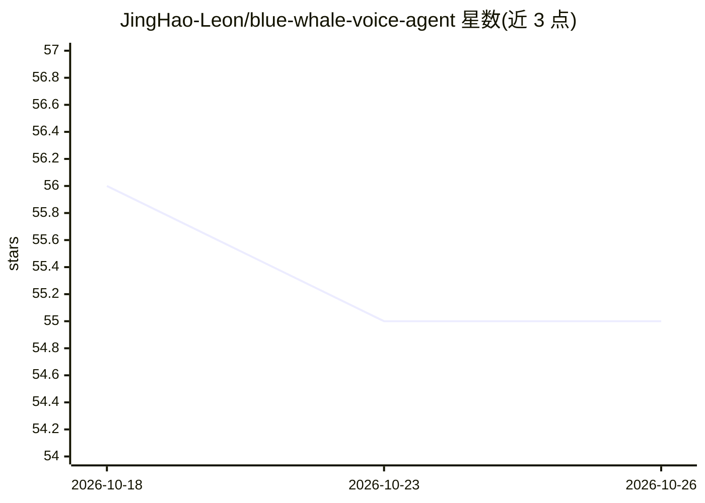

# JingHao-Leon/blue-whale-voice-agent

⭐ 55 · Python · MIT · 推送 2026-09-15 · [GitHub](https://github.com/JingHao-Leon/blue-whale-voice-agent) · 个人维护 · 中文 README

**园区访客登记 AI 语音 Agent：电话/浏览器/小程序三入口，25 秒推企微访客卡**

面向园区门卫场景的端到端语音 Agent 系统，基于 FastAPI 构建。三个入口（PSTN 电话经 Twilio、浏览器 WebRTC、微信小程序）共用同一套 STT→LLM→TTS 管线：阿里云百炼 FunASR 流式识别、通义千问 tool-calling 增量采集车牌/公司/事由/手机号、TTS 播报，对话收口后 1 秒推送 Markdown 访客卡到企业微信群，数据落库 SQLite 供门卫自然语言查询。国际备用栈为 Deepgram + OpenAI，改环境变量切换。局限包括 Twilio 国际长途限制、FunASR 静音 23 秒超时、浏览器入口需公网 tunnel。

## 筛选速览

| 维度 | 判定 | 备注 |
|---|---|---|
| AI 角色 | `ai-native` | 本体是模型或模型工具 |
| 许可风险 | `permissive` | MIT |
| 部署形态 | `self-host` | docker 或自建部署 |
| 模型依赖 | — | README 未给出锁定关系 |
| 硬件要求 | — | 无带数字的原话,不猜 |
| 安装摩擦 | `low` | 无编译、无系统依赖或容器化 |
| 成熟度 | — | 结构信号不足 |

## 能力要点

- 三入口共用一套 STT→LLM→TTS 管线，一处优化三端生效
- LLM 任意顺序提取多字段，text-parser 兜底，自适应 VAD 动态断句
- 挂断唯一收口点保证先通知门卫再挂断，附 25 秒达标测量与并发压测脚本
- 门卫自然语言查询历史访客，/dashboard 看板每 10 秒刷新

## 适用场景

- 园区/写字楼无人值守电话登记访客并通知门卫
- 用浏览器或微信小程序入口做语音登记，避开电话线路限制
- 门卫用对话查询历史访客记录

## 场景标签

`语音 Agent` · 领域:对话与助手

## 证据(README 行号)

> L13: 面向真实园区门卫场景的端到端落地项目。三个入口（PSTN 电话 / 浏览器 WebRTC / 微信小程序）**共用同一套 STT → LLM → TTS 管线**，仅音频 transport 不同：阿里云百炼 FunASR 流式识
> L112: 默认栈是百炼（FunASR 流式识别 + Qwen tool-calling + qwen3-tts-flash，一个 Key 走通三件事）；`.env.example` 里附带 Deepgram + OpenAI 的国际备用栈

## 星数曲线

2026-10-18 56 → 2026-10-26 55（-1）

---
*卡片 v1 · prompt 1.4 · 生成 2026-10-24 · 置信度 high · 依据 README sha `075869ff110a` · [字段定义](../../DATASET.md)*
