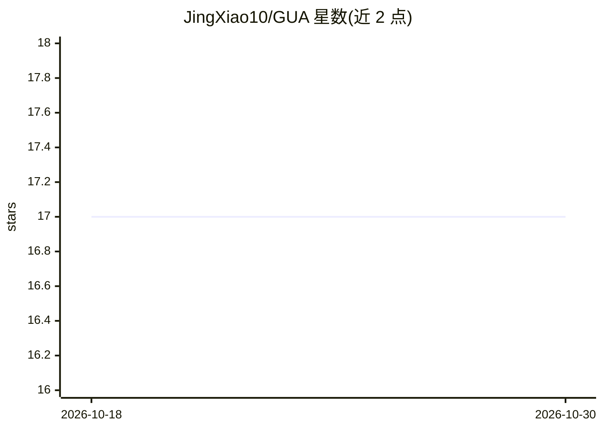

# JingXiao10/GUA

⭐ 17 · Python · MIT · 推送 2026-09-18 · [GitHub](https://github.com/JingXiao10/GUA) · [官网](https://arxiv.org/abs/2609.01558) · 组织维护

**修正梯度手术与优化器不一致的 PINN 无冲突训练方法**

论文官方实现：提出 Gradient-Update Mismatch（GUM）现象——梯度手术构造的无冲突方向经 Adam 等现代优化器变换后可能离开无冲突锥；GUA 在优化器变换之后，将优化器提案在正定度量下投影回无冲突锥，并可对有状态优化器的内部状态做对齐。基于 ConFIG 实现扩展，支持 6 种梯度手术方法、6 个 PDE 方程及 CelebA 多任务实验，实验在单张 RTX 4090 上运行。以 Python/PyTorch 源码仓库形式提供，需 conda 建环境并 pip 安装依赖。

## 筛选速览

| 维度 | 判定 | 备注 |
|---|---|---|
| AI 角色 | `ai-ecosystem` | LLM/agent 周边工具 |
| 许可风险 | `permissive` | MIT |
| 部署形态 | `library` | 以包/库形式分发 |
| 模型依赖 | — | README 未给出锁定关系 |
| 硬件要求 | — | 无带数字的原话,不猜 |
| 安装摩擦 | `medium` | 含编译或系统依赖之一 |
| 成熟度 | — | 结构信号不足 |

## 能力要点

- 在优化器变换后将更新投影回冲突无关锥（GUA 算子）
- 支持 ConFIG/PCGrad/CAGrad/UpGrad 等 6 种梯度手术方法
- 覆盖 Burgers、Schrodinger 等 6 个 PDE 基准与 CelebA 多任务实验
- 可对有状态优化器的内部状态做再对齐

## 适用场景

- PINN 训练中缓解物理残差与边界条件的梯度冲突
- 复现论文中的 GUM 现象与 GUA 对比实验
- 在已有梯度手术方法上叠加更新级冲突修正

## 场景标签

`模型训练` · 领域:训练与推理

## 证据(README 行号)

> L33: **Gradient-Update Alignment (GUA)** operates after optimizer transformation.
> L119: Specifically, after the optimizer transforms $a_t$ into $u_t$, GUA projects $u_t$
> L192: conflictfree/                 Core gradient, conflict, and projection operators

## 星数曲线

2026-10-18 17 → 2026-10-30 17（+0）

---
*卡片 v1 · prompt 1.4 · 生成 2026-10-30 · 置信度 mid · 依据 README sha `3be77cefd8e0` · [字段定义](../../DATASET.md)*
