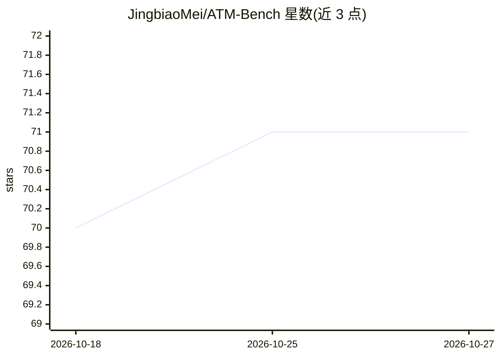

# JingbiaoMei/ATM-Bench

⭐ 71 · Python · MIT · 推送 2026-08-13 · [GitHub](https://github.com/JingbiaoMei/ATM-Bench) · 组织维护 · 中文 README

**长期个性化记忆问答基准：约 4 年多模态数据的指代性问答评测**

面向长期个性化记忆的基准数据集与评测代码库：覆盖约 4 年跨度的图像、视频、邮件等多源多模态数据，任务为指代性查询的证据支撑问答与多源推理。提供 MMRAG、Oracle、NIAH 基线及移植的 A-Mem、HippoRAG2、mem0、MemoryOS 等第三方记忆系统基线，另有 Claude Code、Codex 等通用 Agent 的隔离逐题评测 harness，数据发布于 Hugging Face，并附 Live Leaderboard。

## 筛选速览

| 维度 | 判定 | 备注 |
|---|---|---|
| AI 角色 | `ai-knowledge` | 知识聚合/清单类 |
| 许可风险 | `permissive` | MIT |
| 部署形态 | `library` | 以包/库形式分发 |
| 模型依赖 | — | README 未给出锁定关系 |
| 硬件要求 | — | 无带数字的原话,不猜 |
| 安装摩擦 | `low` | 无编译、无系统依赖或容器化 |
| 成熟度 | — | 结构信号不足 |

## 能力要点

- ~4 年多模态多源数据（图像/视频/邮件）的指代性记忆问答
- 人工标注 QA 对带真值证据，含冲突证据与多源推理
- 提供通用 Agent harness 与 Harbor 数据集（逐题 Docker 隔离）
- 对比 DM 与 SGM 两种记忆预处理表示及 Oracle/NIAH 评测

## 适用场景

- 评测记忆系统或通用 Agent 的长期个性化记忆能力
- 研究指代性查询与多模态证据检索
- 在价格-性能图上比较各 Agent 的表现与成本

## 场景标签

`Agent 记忆` `模型评测` · 领域:Agent 开发

## 证据(README 行号)

> L3: **The first benchmark for multimodal, multi-source personalized referential memory QA over long time horizons (~4 ye
> L26: - **2026-03-04:** Initial codebase release, including baseline implementations for MMRAG, Oracle, NIAH, and four po
> L33: - **2026-05-30:** Released the General-Purpose Agent benchmark harness (`agent_systems/`) — isolated, per-question 

## 星数曲线

2026-10-18 70 → 2026-10-27 71（+1）

---
*卡片 v1 · prompt 1.4 · 生成 2026-10-24 · 置信度 high · 依据 README sha `135053049825` · [字段定义](../../DATASET.md)*
