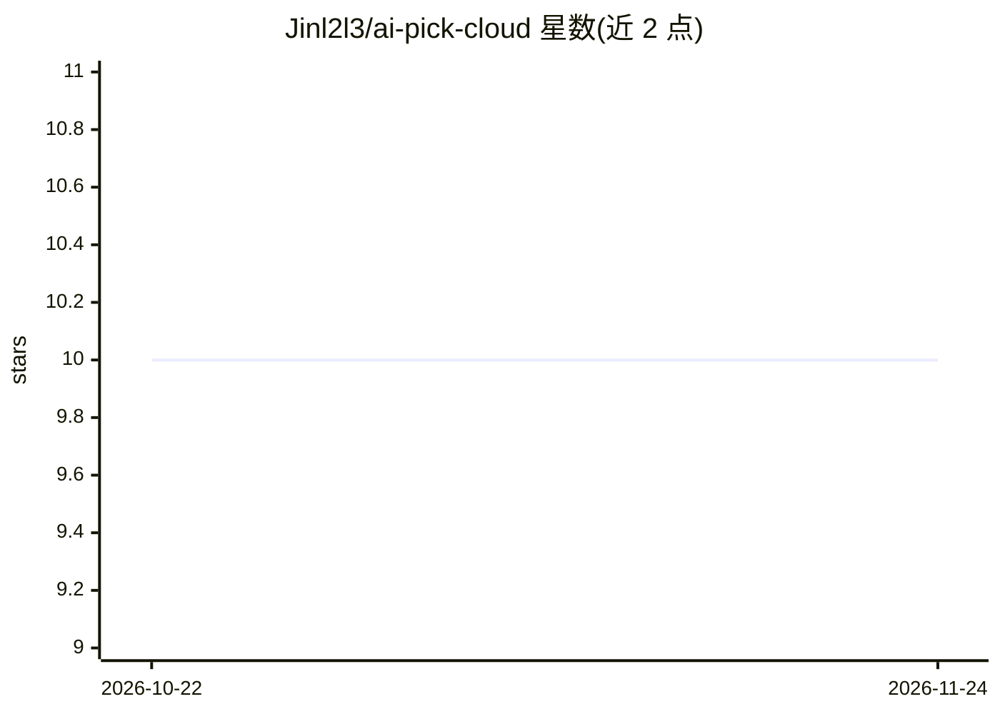

# Jinl2l3/ai-pick-cloud

⭐ 10 · Python · MIT · 推送 2026-02-16 · [GitHub](https://github.com/Jinl2l3/ai-pick-cloud) · 个人维护

**面向本地用户的照片/视频 AI 自动分类整理工具**

PyQt5 图形界面工具，调用视觉大模型识别图片/视频内容后按类别和时间整理文件，并可用 AI 生成的自然语言描述重命名文件。支持本地 Ollama 服务或网络 API（如硅基流动）两种后端，视频通过多帧提取后分类，提供并发处理、任务暂停/继续、网络错误重试、错误文件导出等机制。分类提示词、重命名提示词、JSON 结构化输出均可分别针对图片和视频独立配置。

## 筛选速览

| 维度 | 判定 | 备注 |
|---|---|---|
| AI 角色 | `ai-native` | 本体是模型或模型工具 |
| 许可风险 | `permissive` | MIT |
| 部署形态 | `library` | 以包/库形式分发 |
| 模型依赖 | local-ok | 支持本地模型 |
| 硬件要求 | — | 无带数字的原话,不猜 |
| 安装摩擦 | `low` | 无编译、无系统依赖或容器化 |
| 成熟度 | — | 结构信号不足 |

## 能力要点

- 图片/视频内容识别后按类别与时间整理，支持移动或复制两种操作模式
- 本地 Ollama 与网络 API 双后端，网络 API 支持多模型轮询与并发分配
- 视频多帧提取分类，抽帧位置（中间/随机/首尾帧等）可配置
- 分类/重命名/结构化输出提示词对图片与视频独立配置

## 适用场景

- 整理本地积压的照片和视频目录
- 用 AI 描述自动重命名命名混乱的媒体文件
- 网络不稳定时用本地 Ollama 离线批量分类

## 场景标签

`图像视频处理` · 领域:感知与多模态

## 证据(README 行号)

> L3: 基于大模型的智能图片/视频分类整理工具，支持本地 Ollama 和网络 API（如硅基流动）。
> L7: - 🔍 **智能分类** - 使用 AI 自动识别图片/视频内容并分类

## 星数曲线

2026-10-22 10 → 2026-11-24 10（+0）

---
*卡片 v1 · prompt 1.4 · 生成 2026-11-20 · 置信度 mid · 依据 README sha `74339fe2f527` · [字段定义](../../DATASET.md)*
