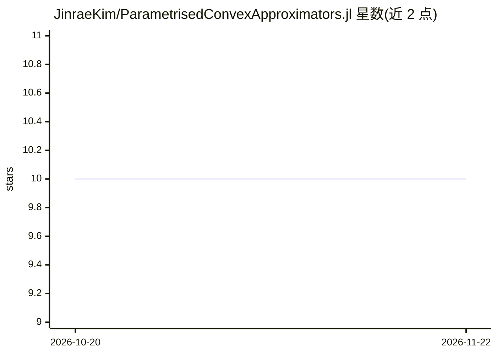

# JinraeKim/ParametrisedConvexApproximators.jl

⭐ 10 · Julia · MIT · 推送 2026-01-07 · [GitHub](https://github.com/JinraeKim/ParametrisedConvexApproximators.jl) · 个人维护

**为 Julia 用户提供参数化凸逼近器网络库**

Julia 语言包，提供预定义的参数化凸逼近器及相关功能，包括 PMA、PLSE、LSE、PICNN、DLSE 等网络类型。支持通过监督学习训练器（SupervisedLearningTrainer）配合 Flux 进行网络训练，提供函数值近似接口与在箱约束下求给定参数的极小值点功能，并支持多线程批量求值。应用于摊销优化（基于学习的参数优化）等场景。安装方式为 Julia REPL 的包管理模式。

## 筛选速览

| 维度 | 判定 | 备注 |
|---|---|---|
| AI 角色 | `ai-native` | 本体是模型或模型工具 |
| 许可风险 | `permissive` | MIT |
| 部署形态 | `None` |  |
| 模型依赖 | — | README 未给出锁定关系 |
| 硬件要求 | — | 无带数字的原话,不猜 |
| 安装摩擦 | `low` | 无编译、无系统依赖或容器化 |
| 成熟度 | — | 结构信号不足 |

## 能力要点

- 提供 MA/LSE/PMA/PLSE/PICNN/DLSE 等预定义凸逼近器
- 提供 minimise 接口在箱约束下求给定参数的极小值点
- 含 DecisionMakingDataset 与 SupervisedLearningTrainer 训练流程
- PLSE(plus) 支持经隐式微分求极小值点的微分

## 适用场景

- 在 Julia 中做参数化凸函数的学习式逼近
- 实现摊销优化（learning-based parametric optimization）
- 为给定参数 x 求解带箱约束的优化变量极小值点

## 场景标签

 · 领域:机器学习/优化工具库

## 证据(README 行号)

> L3: is a Julia package providing predefined parametrised convex approximators and related functionalities.
> L20: ParametrisedConvexApproximators.jl focuses on providing predefined approximators
> L55: best_network = Flux.train!(trainer; epochs=200)

## 星数曲线

2026-10-20 10 → 2026-11-22 10（+0）

---
*卡片 v1 · prompt 1.4 · 生成 2026-11-20 · 置信度 high · 依据 README sha `e533aece3eb8` · [字段定义](../../DATASET.md)*
