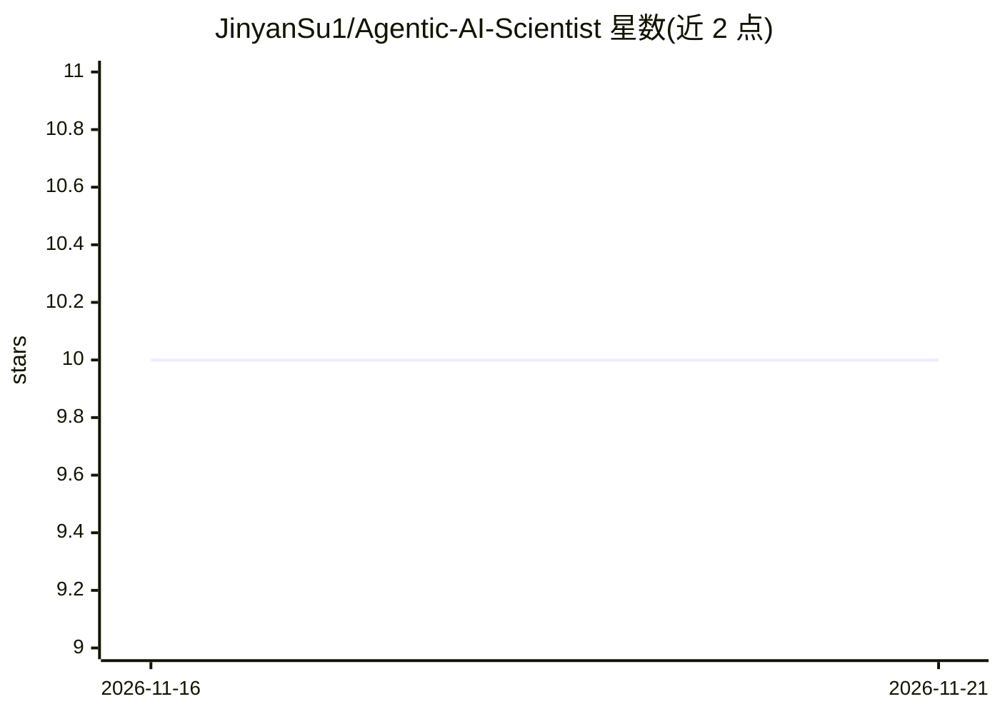

# JinyanSu1/Agentic-AI-Scientist

⭐ 10 · Python · NOASSERTION · 推送 2026-08-08 · [GitHub](https://github.com/JinyanSu1/Agentic-AI-Scientist) · 个人维护

**端到端无人值守的 agent 自动科研循环：出点子、跑实验、写论文**

SakanaAI AI-Scientist-v2 的重构分支：把原来的树搜索管线替换为开放式研究循环——结构化辩论提出想法、小成本试点、深度新颖性核查、开发循环中评估器逐步决定锁定/修订/放弃，最后做多源引文检索、LaTeX 写作（tectonic 编译）与 LLM/VLM 评审。实验代码的编写与运行委托给可插拔的 Codex CLI 或 Claude Code CLI 编码工人；编排层基于 openai-agents SDK，模型后端经 --model 前缀分发。README 明确声明仅 fugu+codex 路径经过端到端验证，其余后端未实测；且默认以绕过沙箱的方式执行 LLM 代码，要求在隔离环境中运行。

## 筛选速览

| 维度 | 判定 | 备注 |
|---|---|---|
| AI 角色 | `ai-native` | 本体是模型或模型工具 |
| 许可风险 | `none` | NOASSERTION |
| 部署形态 | `library` | 以包/库形式分发 |
| 模型依赖 | local-ok | 支持本地模型 |
| 硬件要求 | — | 无带数字的原话,不猜 |
| 安装摩擦 | `low` | 无编译、无系统依赖或容器化 |
| 成熟度 | `idea` | |

## 能力要点

- Proposer/Challenger/Evaluator 辩论式选题 + 试点实证筛选 + 深度新颖性核查
- 编码工人可插拔：Codex CLI（默认）或 Claude Code CLI
- 跨阶段共享知识库缓存论文，持久化 research wiki 记录失败方向
- 写稿接入 Semantic Scholar/OpenAlex/arXiv 多源引文与 tectonic LaTeX 编译

## 适用场景

- 给定种子论文或主题，让 agent 无人值守跑完选题到成稿的完整科研流程
- 只运行选题辩论阶段，产出 JSON 格式的研究想法列表
- 中断的实验循环从 experiments 目录断点续跑

## 场景标签

`编码 Agent` `科研工具` · 领域:编码与开发

## 证据(README 行号)

> L2:  An open-ended, agent-driven automated research loop.
> L4: Agentic AI Scientist is a heavily rearchitected fork of SakanaAI's AI-Scientist-v2. It replaces the original best-fi
> L34: 4. **Development loop** — the Research Agent (`ai_scientist/perform_research_agent.py`) implements/runs/inspects ex

## 星数曲线

2026-11-16 10 → 2026-11-21 10（+0）

---
*卡片 v1 · prompt 1.4 · 生成 2026-11-20 · 置信度 mid · 依据 README sha `ee6e15492399` · [字段定义](../../DATASET.md)*
