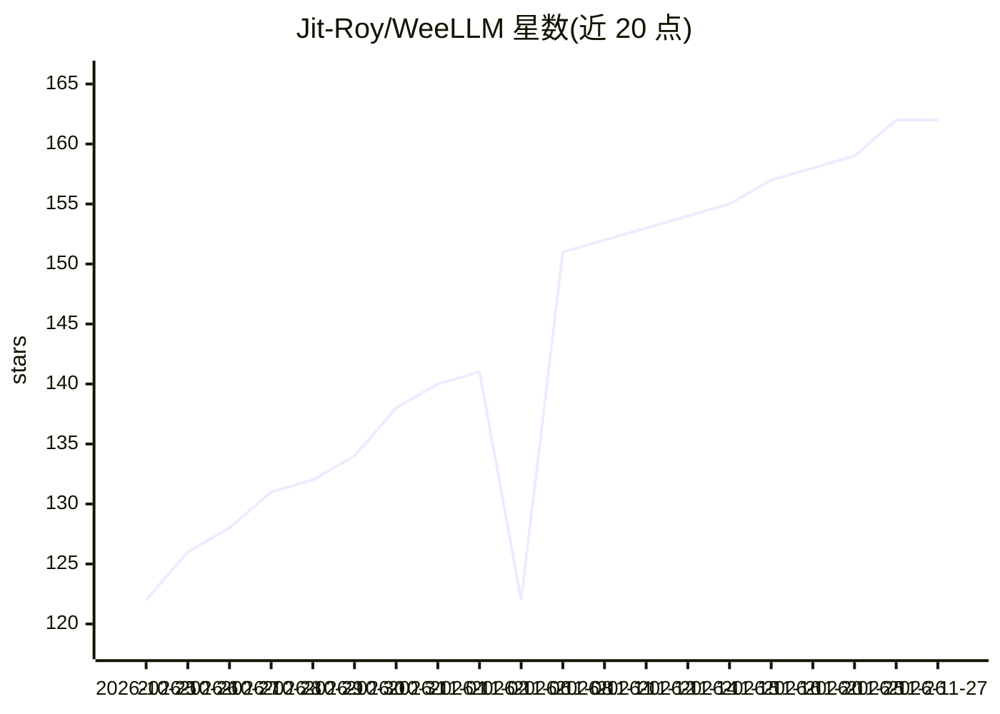

# Jit-Roy/WeeLLM

⭐ 162 · Python · 推送 2026-11-08 · [GitHub](https://github.com/Jit-Roy/WeeLLM) · 个人维护

**4GB 显存即可流式运行大型扩散模型的推理库**

通过层流式架构运行大型扩散模型：按可用 VRAM 动态确定常驻层数，将文本编码器与 transformer 层从存储逐层流式送入 GPU，无需量化即可在低至 4GB 显存的硬件上推理。支持 30+ 文生图模型、图像编辑模型与视频生成模型（SD/FLUX/Qwen-Image/Wan2.2 等），提供 CLI 与 Python API，并可作为 ComfyUI 自定义节点使用。作者注明云实例因磁盘 I/O 限制会变慢，自回归类文生图模型在该架构下耗时不可行。

## 筛选速览

| 维度 | 判定 | 备注 |
|---|---|---|
| AI 角色 | `ai-ecosystem` | LLM/agent 周边工具 |
| 许可风险 | `none` | — |
| 部署形态 | `library` | 以包/库形式分发 |
| 模型依赖 | local-ok | 支持本地模型 |
| 硬件要求 | `gpu-8g` | |
| 安装摩擦 | `low` | 无编译、无系统依赖或容器化 |
| 成熟度 | — | 结构信号不足 |

## 能力要点

- 无量化、bfloat16 权重逐层流式，最低 4GB VRAM 运行
- 支持图像生成、图像编辑、视频生成共 30+ 模型
- 提供 CLI（可传 VRAM/RAM 预算）与 Python API
- 提供 ComfyUI 自定义节点，支持 GGUF 权重流式反量化

## 适用场景

- 在 4GB 显存的显卡上运行 FLUX、Qwen-Image 等大型模型
- 以 CLI 从 Hugging Face 仓库 ID 直接生成图像或视频
- 在 ComfyUI 工作流中以低显存调用大模型
- 在 Kaggle/Colab 笔记本中运行扩散模型推理

## 场景标签

`图像生成` `视频生成` `推理引擎` · 领域:内容生成

## 证据(README 行号)

> L11: # Layer-streaming inference for large diffusion models — Under 4 GB VRAM, no quantization
> L13: WeeLLM dynamically streams text encoder and transformer layers to the GPU for massive models. Instead of forcing th
> L158: from weellm import WeeTextToImagePipeline

## 星数曲线

2026-10-25 122 → 2026-11-27 162（+40）

---
*卡片 v1 · prompt 1.4 · 生成 2026-11-27 · 置信度 high · 依据 README sha `610da48e9037` · [字段定义](../../DATASET.md)*
